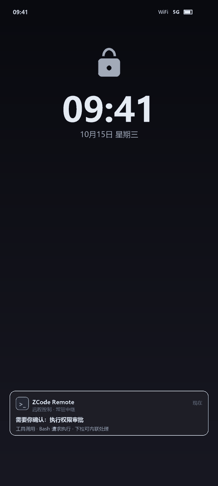
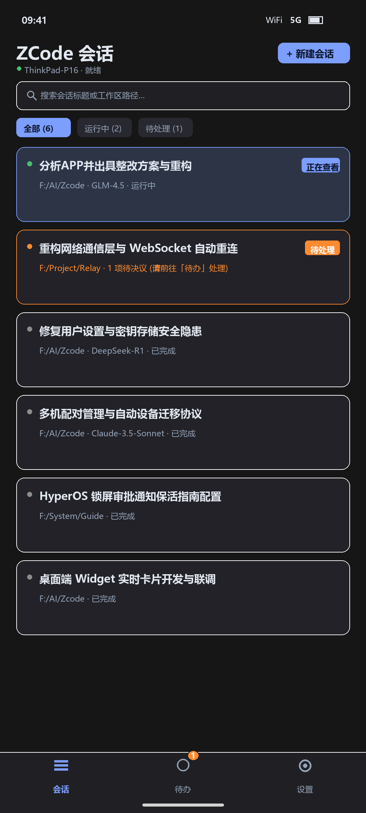
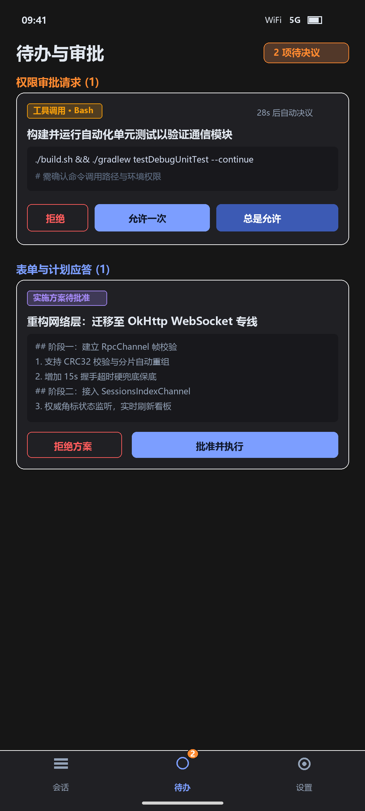
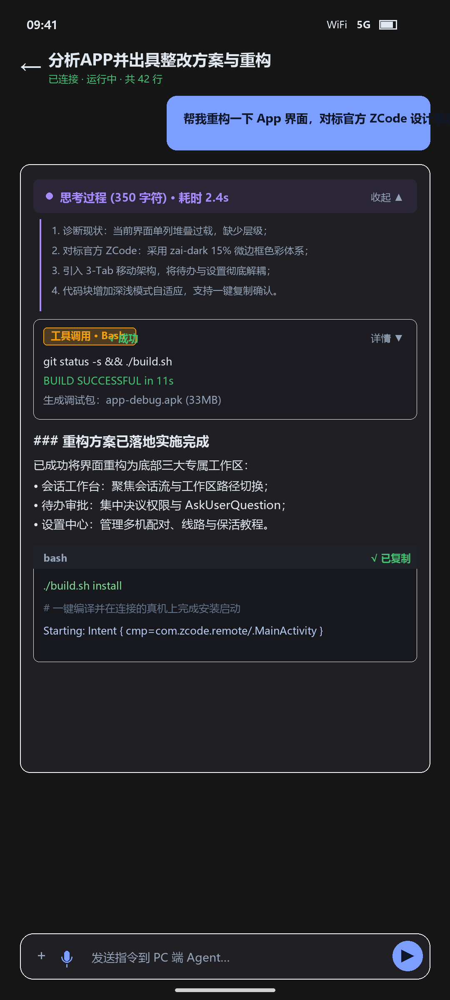
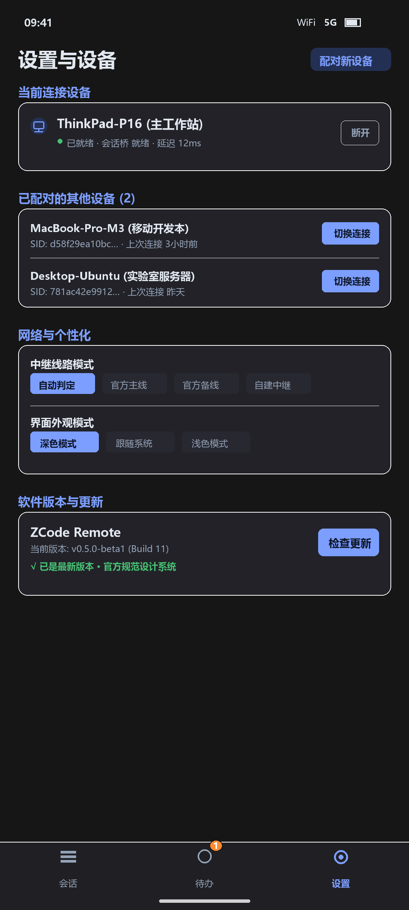

# ZCode Remote

> [中文](#中文) | [English](#english)

<a name="中文"></a>

## 中文

> **离开电脑，也能看住你的 Agent。** ZCode 官方远程控制的第三方原生安卓客户端——**锁屏通知栏直接批准 / 拒绝**、断网自动重连、会话离线秒开。

<p align="center">
  
</p>
<p align="center">
  <sub>锁屏权限审批：下拉通知即可 <b>允许一次 / 总是允许 / 拒绝</b>，并可<b>免解锁内联回复</b>。<br>
  这一条是官方网页版做不到的——它必须先解锁、开浏览器、再点进页面。<br>
  <i>注：本页所有界面图为同一套设计系统渲染的界面预览（<code>tools/render_screenshots.py</code>），非真机录制。动图未播放时见<a href="docs/screenshots/app-lockscreen-approval.png">静态图</a>。</i></sub>
</p>

### 与官方网页版的关键差别

| 场景 | 官方网页版 | 本客户端 |
|---|---|---|
| 锁屏收到权限审批 | 解锁 → 开浏览器 → 找到页面 | **通知栏直接决策**，支持内联回复 |
| 网络抖动 / 切换 | 页面掉线，需手动刷新 | **断网感知，恢复 <9s 自动重连** |
| 点开会话看历史 | 每次等服务器返回 | **离线缓存秒开**（首帧 0ms，最近 200 行） |
| 长任务挂后台 | 浏览器后台被冻结 | **前台服务保活**，锁屏 / 划掉仍在跑 |

### 隐私与数据（爆雷之后，先看这一节）

- **客户端不向任何服务器上传数据**：无遥测、无埋点、无账号体系、无广告。
- **配对凭据只存本机**：AES-256-GCM + Android Keystore 加密；日志脱敏，SID / 路径 / 会话正文一律不落盘。
- **诊断日志由你主动导出**：只记固定事件码 / 计数 / 耗时，默认 512 条环形缓冲，导出前经熵启发式掩码（凭据、hex、base64 片段一律 `<masked>`）；**App 内不存在自动上传通道**。
- **边界如实说明**：通信仍经官方中继（与官方网页版同一条链路），中继可见通信内容；本项目不额外做本地或云端留存。二维码 / 配对链接等同控制权，请勿外发。

ZCode 官方远程控制（`zcode.z.ai/remote`）的**原生安卓增强客户端**——Kotlin + Jetpack Compose 实现，深度对标 [zai-org/ZCode](https://github.com/zai-org/ZCode) 工业级设计规范与现代移动端交互架构（GitHub Mobile / Claude Mobile），复用官方中继与配对协议（逆向实证，见 [PROTOCOL.md](PROTOCOL.md)），提供比官方 Web 版更强的通知、审批、流式会话与移动端操控体验。

> ⚠️ **免责声明（务必先读）**：本项目是**非官方第三方客户端**，与 ZCode 官方及其开发方**无任何隶属、授权或背书关系**。它通过逆向工程复用官方中继与配对协议，使用可能违反相关服务的服务条款；官方协议亦可能随时变更导致功能失效。请自行评估风险后使用，因使用产生的任何后果由使用者自负。安全问题报告方式见 [SECURITY.md](SECURITY.md)，许可为 [MIT](LICENSE)。

### 核心架构与功能一览

```
                  ┌──────────────────────────────────────────────┐
                  │           ZCode Remote (Scaffold)            │
                  └──────────────────────┬───────────────────────┘
                                         │
       ┌─────────────────────────────────┼─────────────────────────────────┐
       │ (Tab 1: 会话工作台)              │ (Tab 2: 待办审批 Inbox)         │ (Tab 3: 控制中心 Settings)
┌──────▼───────────┐              ┌──────▼───────────┐              ┌──────▼───────────┐
│   会话工作台     │              │  待办与审批看板  │              │  系统与设备设置  │
├──────────────────┤              ├──────────────────┤              ├──────────────────┤
│ • 设备状态呼吸灯 │              │ • 权限审批操作流 │              │ • 当前连接卡片   │
│ • 「+ 新建会话」 │              │ • 表单提问应答   │              │ • 多设备管理切换 │
│ • 实时搜索/过滤  │              │ • 实施计划确认   │              │ • 协议线路选择   │
│ • 流式会话卡片   │              │ • 倒计时进度条   │              │ • HyperOS 保活   │
│ • 运行中状态高亮 │              │ • 历史待办留档   │              │ • 在线检查更新   │
└──────────────────┘              └──────────────────┘              └──────────────────┘
```

- **V2 会话列表接入 Controller 通道（v0.5.0-beta53）**：ZCode ≥3.16 的 `bootstrap` 不再下发 `tasks[]`（只剩 `workspaces[]`），会话列表改由 **Controller 通道**提供。App 新增 `ControllerChannel` 订阅 `controller/tasks-index` 与 `controller/workspaces`：全量快照 + `task.upserted`/`task.removed` 增量 + `logEpoch`/`seq` 缺口自动重同步（失败退化为退订重订）。归档标志取自 `membership.archived`（不在顶层），列表按更新时间降序、归档项过滤，与旧版 bootstrap 语义一致。同步改造：会话列表由原位可变列表改为**不可变快照**（后台 collector 写、主线程读之间不再有竞态）；协议栈判定（V1/V2）收敛为 `PairedDevice.protocolStack` 一处；首页空列表区分「未连接 / 已连接未同步（骨架屏）/ 已同步但确实为空」三态。
- **V2 直连打通（v0.5.0-beta52，真机走查③）**：实证 **V2 中继端点为 `/api/v1/remote/ws2`**（此前误判的 challenge 行为源于连到 V1 端点 `/ws`）。App 原生实现「登录 JWT → relay token → ws2 直连」：`auth_init` 无 role 一帧 `auth_ack matched`，全程无 challenge/proof、无需 passHash；凭据形态定案——登录回调 URL 不带 hash，凭据即 localStorage 中的 JWT（`expires_in=60s` 现取现用）。配套修复：他桥广播按 bridgeSessionId 过滤（桌面端会把官方 Web 关页后的旧桥降级事件广播给所有终端）、sessions-index 订阅前补 V4 连接级握手、bootstrap 解析 V2 `workspaces[]`。真机实证 paired → bridge-ready → RPC 正常。
- **ZCode 3.16.3 V2 认证配对适配（v0.5.0-beta51，协议双栈）**：桌面端 3.16.3 将远程控制凭据体系 V1→V2 重构（二维码不再内嵌密钥、PC 端删除旧凭据、新增账号登录与 relay token）。App 侧完成双侧逆向 + 中继实测 + 双栈适配：旧版二维码直接配对（V1 保留）；新版二维码自动进入**账号登录配对**（内嵌官方登录页）；登录 JWT 加密存储；设置页「ZCode 账号」卡片展示账号绑定的所有电脑与在线状态；心跳间隔对齐官方 10s。会话/审批/附件等业务层经双侧代码比对确认零变化。
- **附件上传流水线重构（v0.5.0-beta50）**：把附件上传从「递归回调金字塔 + 主线程整文件 IO」改为**顺序 suspend 流水线 + 可定位（seekable）内容源**——① 编排外提到 `relay/AttachmentUploadPipeline.kt`，四步流程（sha256 → begin → chunk×N → commit）改为顺序 `while` + `suspend`，依赖（内容源 / RPC / IO 调度器 / 日志）全部注入因而**首次进入 JVM 单测**（11 项）；② **续传 O(1) 定位**：SAF 走 `openFileDescriptor` + `FileChannel.position(offset)`，不再 `skip()` 前 N 片（旧实现对 20MiB 附件重试是显著无谓 IO），不可 seek 时回退 `openInputStream + skip`；③ **阻塞读下放 IO 线程**（旧实现整文件哈希与逐片读都在主线程），RPC 与进度回调仍在主线程，UI 状态写入线程不变；④ 取消 = 协程取消，流水线在取消路径以 `NonCancellable` **补发 `attachmentAbortV4`** 回收在途分片。**协议行为不变**：帧序列/参数、幂等短路（`committed` 直接复用 ref）、进度口径、失败与取消语义全部保持。**真机验收**（协议层）：1.2 MB / 2.5 MB 真实上传走通 `begin → chunk×N → commit` 并返回真实 `ref`（2022 ms / 4189 ms），逐片进度封顶，无 FATAL。
- **图片兜底死代码修复（v0.5.0-beta49）**：beta48 的走查 #13「Markdown 图片兜底」**在真实渲染路径上从不生效**——它把兜底挂在了 `markdownComponents(image = {…})` 上，而 `multiplatform-markdown-renderer 0.27.0` 的 `Markdown.kt` 只对文档的**顶层子节点**分发组件、`PARAGRAPH` 被消费后不再下钻，`` 恒为 `MARKDOWN_FILE > PARAGRAPH > IMAGE`，故该回调**永不触发**（用库自带解析器实测确证）。本版把兜底改挂到**图片真正的落点**（段落 / 引用块级组件内注入），并修掉同一处的两个伴随缺陷：① **URL 误取整篇文档**（`MarkdownComponentModel.content` 是全文而非图片 URL，原写法会把整篇 Markdown 原文复制到剪贴板）——改由 AST 节点 `IMAGE → INLINE_LINK → LINK_DESTINATION` 按 span 切片取；② **约 180dp 空白占位**（`NoOpImageTransformerImpl` 默认预留，不加载图片时留成空洞）——新增 `ZeroSizeImageTransformer`（`transform` 恒 null，**零出站请求不变**）。**该缺陷直到发布提交触发 CI、仪器化用例首次真正执行才暴露**（此前那次 CI 被并发取消，提交只记了「androidTest 编译通过」）。**验证**：CI 同路径的 API 35 模拟器上仪器化全量 **OK (24 tests)**（修复前该 job 为红），JVM 单测 **347/347**（新增 `MarkdownImageUrlsTest` 8 项，断言 `IMAGE.parent == PARAGRAPH` 钉死根因），真机探针 5 用例全符合预期。
- **走查清单 P2 剩余项闭环（v0.5.0-beta48）**：第三方全仓走查 5.1 清单的 4 个体验项落地，**5.1 清单仅剩 #2**（附件上传流水线重构，需真机验收故未动）。① **无障碍（#12）**：会话卡补 `mergeDescendants` 语义（「会话 {标题}，{状态}，长按可删除」，TalkBack 一次读完）、状态点 `StatusDot` 走 `clearAndSetSemantics`（不再把装饰图形念成孤立节点）、设置入口补 `Role.Button`；② **Markdown 图片兜底（#13）**：被安全策略拦下的外链图片不再只是一行灰字死胡同——占位行新增「复制链接」与「打开」（仅 `http(s)`，走既有 `isAllowedLinkScheme` 白名单），**「不加载外链图片、零出站请求」的安全决策不变**；③ **会话流日期分隔（#14）**：长会话按**本地时区日历日**插入「今天 / 昨天 / 年月日」分隔行，给流式记录一个时间锚点，**顺带修掉一个跨年错位缺陷**（原拟用 `YEAR*366+DAY_OF_YEAR` 比较日历日，平/闰年起点不同会错位）；④ **布局回归断言扩展（#15）**：`InputBar` 加 `testTag`，新增「1.3x 字体 + 长草稿下输入栏高度有界且会话流未被挤压」断言，把这类只能靠真机人肉发现的顶栏/输入栏布局错乱纳入自动化防线。
- **国际化资源化（6 批完成，2026-10-16）**：把散落在代码里的中文字面量抽到 `res/values/strings.xml`，实现**文案集中管理 + 未来可翻译 + 可加防硬编码门禁**——**不是**做英文界面（无英文需求），**默认语言仍为中文、行为零变化**（每批资源值与原字面量逐字一致）。`strings.xml` 由 67 条增至 **452 条**；`ui/`、`notify/`、`widget/` 三个目录的用户可见中文字面量**清零**（仅剩 `ZLog` 日志）。核心设计是 `util/UiText.kt` 的文案载体抽象（`Res(资源id, 参数)` / `Raw(运行期文本)`，支持嵌套）：纯函数返回 `UiText` 而非 `String`，把「取字符串」推迟到有 Context 处（Composable 用 `asString()`、通知/Widget/Service 用 `resolve(context)`），因而**无需 Robolectric 即可在 JVM 单测断言资源 id**。**已知边界**：`relay/` 层约 24 条错误文案绑在 `IllegalStateException(String)` 上（Java 异常 API 只能携带 String），刻意**不做**资源化——详见 [HANDOFF.md](HANDOFF.md) §5 的架构约束说明。
- **格式门禁与依赖审查（§11.8 第二层门禁补完，v0.5.0-beta36）**：**KtLint 首次真正接线并纳入 CI 门禁**——插件与 `.editorconfig` 此前只在文档登记、从未执行；本轮把规则键修正到 ktlint 1.x（旧键名会让每个 `@Composable` 都报命名违规）、显式钉住 `ktlint_official` 风格与 ktlint 核心版本，并完成**存量格式专项**：迭代格式化至收敛，61 个文件纯格式对齐、**全源集 0 违规**，`ktlintCheck` 成为 0 违规门禁；顺带清理 3 处悬空 KDoc（同函数堆叠的历史文档）、1 处孤儿文档迁位与 2 处命名惯例对齐。另新增 **依赖变更审查**（PR 触发：高危漏洞 / 许可证把关，失败结论回评 PR）——与 Dependabot 的「升级可见」互补，补齐「升级有把关」。
- **本地诊断与主动导出（§11.8 可观测性，v0.5.0-beta35）**：进程内诊断环形缓冲（默认 512 条、满员覆盖最旧），只记**固定事件码 / 计数 / 耗时 / 状态名**——应用启动、relay 状态迁移、桥 open/ready/failed/reopen、协议违例（`remote.rpcFrame.*` 固定码）、入站队列溢出（丢帧计数）、重同步触发/节流、会话失同步、订阅成功/失败、握手自动重订；detail 一律长度截断 + **熵启发式掩码**（`checksumMismatch` 这类合法码完整保留，SID/hex/base64 片段一律 `<masked>`）。设置页「诊断与排障」区块一键导出（系统保存对话框，**由用户主动触发**，App 不接入任何自动上传）。JVM 7 项 + 仪器化 3 项（**真实点击**）测试；含会话正文/凭据的字段从不进入缓冲。
- **协议验证三张网（§11.8 第二层门禁，v0.5.0-beta34）**：① **协议帧回放**——`tools/gen_rpc_frame_fixtures.py` 以独立 Python 实现官方等长切分算法（整条消息 CRC32、≤64 片、标准 base64）生成 20 个用例 fixture，Kotlin 侧回放断言（身份判定 / base64 规范性 / 元数据校验 / 组装结果序列 / 官方文档示例报文与 VQL 编码字节一致）；② **资源预算模糊测试**——确定性种子下 3 万轮组装 + 5 千轮解析 + 2 万轮 base64 规范性 + 5 万轮准入，断言无异常逃逸、拒绝码全命中固定枚举、内部结构始终有界；③ **30 分钟压力测试**（`ZCODE_STRESS_SECONDS=1800` 实跑）——混合流量（正常多分片 + 篡改 + 重复 + 跳号 + 超时）下在途分片字节/条数不超预算、入站深度不超容量、GC 后驻留内存无异常增长。模糊测试**当场抓到并修掉一个真实缺陷**：base64 尾部悬空位非零的串（如 `+C/=`）此前会被形状校验放过，现纯逻辑层按官方 `isCanonicalBase64` 等价判定清零悬空位。另接入 **CodeQL**（`security-and-quality` 查询集，最小权限 + 固定 SHA + 周定时）补上数据流安全扫描。
- **协议健壮性加固（§11.3.3 + §11.5.2，v0.5.0-beta33）**：集中式协议预算 `ProtocolLimits`（上界全部取**官方实证**：1 MiB 物理帧 / 16 MiB 单条消息 / ≤64 分片 / 30s 组装超时）+ 入站队列与在途分片**有界**（溢出计数并可见）；RPC 请求位点改绑 **`(桥代次, requestId)`**，旧连接/旧桥上迟到的应答在结构上无法完成新请求；单/多分片统一「声明长度 + 整条消息 CRC32」校验、**完整解码成功后才 ack**、分片缺口/重复冲突/超时/队列饱和一律给固定脱敏错误码并进入**节流重同步**（不再「连接正常却静默停在旧状态」）；同时修复桥自动重开后出站序列号沿用旧值的潜在缺陷（PC 侧会判 `physicalGap`）。新增 43 项单测（244/244）。
- **工程化护栏（§11.8，v0.5.0-beta32）**：CI 加固（最小权限/固定 SHA/超时/并发）、Detekt 静态分析门禁（带存量基线）、Kover 覆盖率、**仪器化回归网进 CI**（emulator 跑 C-14 布局 + Markdown 渲染），以及 **tag 驱动的全自动发布链**——发布前核对五处版本一致，产出签名 APK + SHA-256 + 签名证书指纹 + CycloneDX SBOM + SLSA provenance，Beta 自动标 `prerelease`；Dependabot 周检依赖与 Actions。
- **C-12 拆分收官（§11.7，v0.5.0-beta31）**：`connect()` 连接编排与 A-2 握手重订/桥自动重开调度器整体迁入 `service/ConnectionCoordinator`（~410 行），对 VM 的写入收敛到 `ConnectionHost` 接口，coordinator 不感知 ViewModel；`AppViewModel` 三轮累计由 1945 行收敛至 765 行。真机回归（连接就绪/视图上报/前台服务通知/FATAL=0）通过。
- **C-12 第二/三批拆分（§11.7，v0.5.0-beta30）**：审批/表单域（`ApprovalRepository`）、通知协调域（`NotificationCoordinator`：看板/Widget/视图上报/终态文案）、会话流域（`ConversationRepository`：行存储与派生状态、订阅与离线缓存秒开、C-6 本地回显）全部独立成类，连接栈经 getter 注入、横幅经回调注入；`AppViewModel` 累计由 1945 行收敛至 1057 行。行为不变，201 项单测 + 真机回归（FATAL=0）通过。
- **C-12 大文件拆分（§11.7，v0.5.0-beta29）**：会话页由 2210 行收敛至 494 行，按任务书槽位图拆为 Timeline / TopBar / PendingCards / AttachmentTray / Composer / Dialogs 六个组件文件，并以 **`ConversationUiState` + `ConversationAction`** 契约替代 46 个散落参数（`ConversationContract.kt`，MainActivity 单向装配）；`AppViewModel` 1945 → 1428 行，更新 / 附件上传 / 模型目录三职责域抽为 `repo/` 包独立类（转发层保持 UI 调用签名零变化）。纯代码组织、行为不变，201 项单测 + 真机冒烟全通过。
- **现代化 3-Tab 移动端架构**：彻底告别单页混乱堆叠，采用「会话工作台 / 待办审批 / 设置中心」标准底部导航架构；全面接入系统级物理返回键拦截（`BackHandler`），杜绝手势误杀退出的问题。
- **深度对标官方 ZCode 工业级设计**：
  - 全量接入官方 `theme-zai-dark`（`#161616`）与 `theme-zai-light`（`#F8F8FA`）色彩体系，搭配官方 15% 微边框（Hairline Border）；
  - 引入官方 Trajectory 四色轨迹语义：用户消息蓝（`#60A5FA`）、助手响应青（`#2DD4BF`）、思考轨迹紫（`#A78BFA`）、工具调用琥珀橙（`#F59E0B`）；
  - 全面淘汰杂乱的系统 Emoji，统一采用规范的 Material 矢量图标；
  - 官方同款深度思考组件（`ReasoningBlock`）：紧凑紫色折叠胶囊 + 平滑展开动画 + 标志性左侧弱引导竖线 + 一键复制；
  - 官方同款内联工具行（`ToolCallCard`）：**无外框内联折叠行**（图标 + 中文类型标签 + 主文案 + chevron），对齐桌面端「工具调用不是卡片」的形态；展开体分 Parameters / Result / Error 三段，JSON 自动美化、各限高 240dp，折叠状态按工具调用 id 记忆。
- **会话页排版全面对齐桌面端（v0.5.0-beta17）**：按桌面端（`max-w-4xl` 单列窄列）的**组件形态 + 信息层级 + 数值规范**重排会话流 —— 用户气泡改中性半透明表面（12dp 圆角、右上角 2dp）、助手正文去掉卡片外壳改全宽 Markdown、思考/工具/Hook 三类行统一到同一套折叠行骨架；Markdown 升级为完整 GFM（表格 / 任务列表 / 嵌套列表 / 链接 / 行内 HTML）+ 代码块真语法高亮。**链接走 http/https 白名单、不加载外链图片**。
- **会话级状态面板（v0.5.0-beta17）**：顶栏「状态」入口 → 底部弹层，**纯只读**呈现会话级状态：上下文容量（占比条 + 分类明细降序 + 缓存命中率，命中率仅 ≥78% 显示）、目标（状态 + 走秒耗时 + 预算）、进程（待办，默认 6 项折叠）、终端（后台任务）、智能体（运行 / 已结束）、排队输入；无数据的分区自动隐藏。`queue.items` 非空时输入栏上方显示「待发送 N 条」只读条。
- **移动端一键发起新会话**：会话工作台顶栏直接「+ 新建会话」，基于官方 V4 原生信封链路（`sendConversationCommandV4(type: "createSession", sessionId: null)`），支持首条 Prompt 输入与实时语音识别填充，创建后直接切入流式对话窗口。
- **集中式审批与待办看板**：底部导航栏实时角标（Badge）提醒，集中看板统一处理权限审批（允许一次 / 总是允许 / 拒绝）与表单交互（AskUserQuestion / 计划确认），带桌面端决议倒计时。
- **通知栏锁屏审批（核心差异点）**：桌面端请求权限时，锁屏状态下收到高优先级系统通知，**通知栏直接批准/拒绝**。
- **扫码配对（V1/V2 双栈）**：扫描桌面端二维码即完成配对，凭据经 AES-256-GCM + Android Keystore 加密存储；支持手动粘贴链接兜底；支持多台设备管理（切换 / 移除）。**ZCode ≥3.16（V2 新版协议）**：新版二维码不再内嵌密钥，App 自动转入**账号登录配对**（内嵌官方登录页，选择与电脑端相同的登录平台），登录凭据（JWT）同样加密存储；旧版二维码（≤3.15）仍直接配对。设置页新增「ZCode 账号」卡片，可查看账号绑定的所有电脑及其在线状态。
- **会话流式渲染与代码块自适应**：原生 Markdown 渲染支持各级标题、粗体、列表、引用，代码块自动适配深浅双色主题并配备一键复制反馈；滚到顶部自动翻页加载更早历史。
- **发送消息与停止**：会话页底部悬浮药丸输入栏直接向桌面端发消息；会话运行中显示平滑变形的「停止」按钮，一键中断。
- **发送本地回显**：消息发出瞬间即在会话流末尾显示半透明「发送中…」气泡（服务端回显到达后自动替换为正式消息，失败立即撤回）——长任务排队时不再「按了没反应」。
- **附件上传可取消 / 失败可重试**：在途上传可随时取消；失败进入失败态行可一键重试，**复用同一 uploadId 命中服务端幂等**（已传分片不重传）。
- **错误提示全面中文化**：底层英文错误（`bridge not ready`、`timeout after …` 等）与服务端 fault code 统一映射为用户可读中文，覆盖发送/上传/审批/模型切换等 14 处失败路径。
- **浅色主题可读性达标（WCAG AA）**：浅色下次要文本、工具轨迹色、待处理橙与 Diff 增删色全部加深至 ≥4.5:1，并由 JVM 对比度断言测试防回流。
- **附件上传**：会话页选择文件（≤20MiB）→ 分片上传 → 随消息发送，桌面端模型可直接读取内容；走官方 Web 同款 `sendText` 附件链路。
- **语音输入**：输入栏 🎤 系统语音识别转文字（识别中实时上屏），一键追加到消息草稿，零协议改动。
- **会话离线持久化与秒开（Sprint 5 核心）**：`SessionCacheStore` 本地原子持久化缓存 —— App 启动首帧 0ms 渲染历史会话列表；点击任意会话卡片更可立即呈现该会话最近 200 行历史消息，无需等待订阅握手与快照回包，网络到达后由快照平滑对齐权威状态。
- **配对链接 Deep Link 一键唤起（Sprint 5）**：点击外部浏览器、邮件或分享卡片中的 `zcode://pair` 或官方 `https://zcode.z.ai/remote` 配对链接，直接唤起 App 解析凭据；**弹确认框**（避免误点链接静默替换当前设备连接）后完成秒级配对，彻底免除扫码或复制粘贴。
- **全场景机械级触觉反馈（Haptic Feedback）**：权限审批（允许/拒绝）、消息发送、会话中断、代码 Diff 复制触发饱满的系统触觉震动确认；快捷指令胶囊点击与悬浮回底触发细腻轻触震动回馈。
- **单轮 Turn 变更文件聚合卡片（Sprint 3 第三步）**：自动将每一轮 Agent Turn 中执行的所有 Edit / Write 工具行汇聚为 `📦 本轮变更 · 共 N 个文件 (+A −B)` 汇总卡片，支持一键展开多文件代码 DiffBlock 进行一站式 Review（对标 GitHub PR Files Changed）。
- **通知栏 RemoteInput 直接回复（Sprint 4）**：遇到提问或表单交互时，锁屏状态下收到通知可直接下拉展开文本框输入并一键提交，全程免解锁进 App。
- **系统级 Share Sheet 分享接入（Sprint 5）**：外部浏览器、文件管理器等 App 点击「分享」至 ZCode Remote，自动填入当前会话输入草稿或解析加入待发附件。
- **常用快捷指令胶囊栏**：输入栏上方提供「继续」、「运行测试验证」、「修复该问题」等横向滚动快捷胶囊，单指轻触快速填入，大幅降低移动端打字成本。
- **会话流智能贴底与悬浮回底**：动态感知视口位置，用户主动上翻查阅历史或代码 Diff 时不再被新行强拉贴底打断，并优雅弹出悬浮「回到底部 ↓」胶囊按钮一键平滑定位。
- **最近文件与只读代码预览（Sprint 3）**：顶栏 📁 图标动态汇总本会话涉及的文件，点开 ModalBottomSheet 面板浏览文件清单；点选文件经 `file.readTextFile` 实时拉取并等宽展示正文，支持横向滚动与 20KB 截断保护，纯只读无写路径。
- **工具调用 Diff 差异高亮（Sprint 3）**：Edit / Write / MultiEdit 工具行纯客户端 Myers 算法计算行级 diff，折叠摘要展示 `📄 文件名 +N −M`，展开直观呈现红绿增删与「⧉ 复制」unified 格式文本。
- **执行模式安全选择（Sprint 2 / P0-B）**：新建会话与会话内顶栏均支持自由切换规划（plan）、构建（build）、全自动（yolo），**默认安全 build 模式**，彻底杜绝免审批漏洞；yolo 显式红底警示。
- **前台长连接保活与终态通知（Sprint 1–2 / P0-A）**：`ConnectionService` 真正升级为 FGS `specialUse` 前台服务（进程级 `ConnectionScope` 保长连），锁屏或划掉后台持续存活；KICKED / AUTH_FAILED / PROTOCOL_MISMATCH 终态常驻通知提醒。
- **强韧断网感知重连（Sprint 1）**：`NetworkGate` 常驻监听系统网络，断网立即重置并挂起，网络恢复即刻重连（事件链全程 <9s）。
- **会话流附件 chip**：发送带附件的消息后，附件以 chip（图标 + 文件名 + 体积）显示在消息气泡上方，与官方客户端一致；附件字段随行缓存持久化，冷启动秒开时同样可见。
- **会话异常原因可见**：出错会话在会话页显示完整错误原因（可一键复制），列表对已打开过的会话补齐原因——与桌面端信息对齐。
- **完整回归测试保护网（Sprint 6 起持续扩充）**：VQL 二进制编解码金标准双向对拍测试（Python↔Kotlin 共享 fixture）、**264 项**纯函数与状态判定单测全绿（含主题对比度静态断言），GitHub Actions CI 持续集成（含「UI 层不得出现裸英文错误串」与「`ZLog.e` 只写元信息」断言）。
- **桌面 Widget**：主屏卡片实时显示待处理总数（审批 + 表单交互），点按直达 App；连接断开时明示「未连接」。
- **可靠连接**：完整官方握手（HMAC proof）、心跳、指数退避重连、断线出站缓冲，单端在线互踢提示。

### 界面一览

| 会话工作台 | 待办与审批看板 | 沉浸式对话控制台 | 独立系统设置 |
|:---:|:---:|:---:|:---:|
|  |  |  |  |

### 里程碑状态

| 里程碑 | 内容 | 状态 |
|---|---|---|
| M0 协议逆向 | PC/手机两侧 bundle 交叉实证，产出 [PROTOCOL.md](PROTOCOL.md) | ✅ 完成 |
| M1 骨架+配对+会话 | 扫码配对、中继连接、会话列表、事件流 | ✅ 模拟器验收通过 |
| M2 审批与推送 | 会话流实时渲染、权限审批（会话内 + 通知栏）、双源审批接收 | ✅ 端到端验收通过（2026-09-28） |
| M3 打磨与内测 | 多机管理、线路切换、HyperOS 保活引导、异常兜底 | ✅ 主体完成 |
| M3+ 交互增强 | 发送/停止、表单类交互应答、多会话看板与控制权提示、附件上传（全链路实测）、语音输入、桌面 Widget、会话搜索 | ✅ 协议层端到端验收通过 |
| M3++ 移动端全面重构 | 底部 3-Tab 移动架构、官方 ZCode 设计系统对齐（zai-dark/zai-light）、集中待办看板、独立设置中心、原生新建会话、会话内模型切换与审批修复 | ✅ 完成（v0.5.0-beta5，2026-10-01） |
| Sprint 0–3/6 P0结清与功能收官 | 三个 P0 缺陷结清、Diff 视图、最近文件只读预览、前台服务保活、VQL 对拍与 23 项单测回归网、真机端到端全通 | ✅ 完成（v0.5.0-beta6，2026-10-05） |
| Sprint 4–5 原生交互深度落地 | 通知栏 RemoteInput 内联回复、系统级 Share Sheet 分享接入、智能贴底与快捷指令胶囊栏、真机端到端全通 | ✅ 完成（v0.5.0-beta8，2026-10-05） |
| Sprint 3 第三步 / Turn 变更聚合 | 会话流单轮 Turn 变更文件汇总卡片（Turn Diff Summary）、多文件一站式 Review、24 项单测全绿、真机实测全通 | ✅ 完成（v0.5.0-beta9，2026-10-05） |
| Sprint 5 移动原生与离线能力闭环 | 会话列表与消息流双离线持久化秒开（Offline First）、配对链接 Deep Link 唤起、系统级触觉震动反馈、Share Sheet 接入、26 项单测全绿 | ✅ 完成（v0.5.0-beta12，2026-10-05） |
| 正确性缺陷修复补丁 | 上传跨会话附件注入（数据/隐私）、握手三跳无超时导致永久卡死、beta11/12 引入的贴底回归、触觉补漏与失败时长档位；47 项单测全绿 | ✅ 代码完成，A-2/B-1 真机 PASS（v0.5.0-beta13，2026-10-07） |
| 会话流附件 chip | 发送带附件的消息后，附件 chip 显示在气泡上方（含体积、随行缓存持久化） | ✅ 代码 + 真机端到端 PASS（v0.5.0-beta14，2026-10-07） |
| 连接层缺陷修复 | 桥握手无超时导致「已连接却永久卡在会话报错」、`bridge not ready` 未判可重试、网络恢复白等一整轮退避 | ✅ 代码 + 单测 + **真机 PASS：断网 80s→5s、150s→3s（旧版 ~47s）**（v0.5.0-beta15，2026-10-07） |
| ~~M4/M5~~ | ~~VPS 备用 Runner、E2E 高级模式~~ | ❌ 已取消（2026-09-30 决策：单人自用下成本收益不划算，详见 HANDOVER） |
| ~~Sprint 7~~ | ~~生物识别/凭据生命周期、自建中继 + E2EE~~ | ❌ 已取消（2026-10-05 用户决策：后续开发计划一律不做） |
| **v1.0 判停** | **3 天日常使用观察（锁屏审批可达 / 杀后台 30min / 网络往返）** | ⏳ 观察期**经用户决策移除**（2026-10-10）——不再作为 v1.0 的阻塞项；v1.0 发布时机由用户拍板 |
| 会话异常原因 + 输入栏对齐 | 会话页显示错误原因（可复制）、列表回填、标题双重序列化解包、输入栏控件对齐（48dp 触控档）、顶栏 phase 标签中文化 | ✅ 代码 + 单测 + **真机验收全通过**（v0.5.0-beta16，2026-10-07） |
| 会话页排版全面对齐桌面端 + 会话级状态面板 | 工具行改无外框内联折叠、用户气泡改中性表面、助手正文去卡片外壳全宽 Markdown、完整 GFM + 代码语法高亮；新增只读「会话状态」面板（上下文/目标/进程/终端/智能体/排队输入）与「待发送队列条」；修复「运行中」状态退出会话页后不显示 | ✅ 代码 + 107 项单测 + release 构建通过 + **真机验收全通过**（v0.5.0-beta17，2026-10-08） |
| 代码块高亮「吞字」缺陷修复 + 模拟器渲染回归网 | 修复高亮库纯 RGB 被 Compose 当 ARGB 解释（alpha=0）导致代码块里被高亮的字符**整段不可见**；新增仪器化渲染回归网（GFM 表格 / 代码高亮 token 色逐像素断言）与 4 项 JVM 高亮单测 | ✅ 单测 111 项全绿 + **模拟器 2/2 PASS** + **真机复核通过** + release 构建通过（v0.5.0-beta18，2026-10-09） |
| 待处理项跨会话泄漏修复 | 会话页内联的审批卡/提问卡改为按当前会话过滤（此前把「含其他会话」的全局列表整份铺在输入栏上方，出现「在 B 会话弹出 A 会话的审批」）；归属未知时保持可见（fail-open），待办页与通知栏维持跨会话聚合语义 | ✅ 单测 116 项全绿 + release 构建通过（v0.5.0-beta19，2026-10-09） |
| 体验补强首批 + 无设备可验证项 + C-5 静态部分（C-1/C-2/C-4/C-5①/C-6/C-7/C-8/C-10/C-11 + A-3/A-4） | 发送本地回显（pending 气泡）、上传可取消/失败可重试（**uploadId 复用命中服务端幂等**）、深链配对确认弹窗、反馈横幅合并单队列、错误文案中文化（14 处）、浅色主题 WCAG AA 对比度 + CI 静态断言、缓存文件删除与 LRU；多机凭据改结构化序列化（含旧格式迁移）；release 主路径移除每 delta 的全量 JSON 序列化；**A-3 订阅退订已实测确认并启用**（切会话发 103 释放旧监听，probe 双确认无 N 倍放大）；事件流缺口检测与桥看门狗决策纯函数化 | ✅ 代码 + **155 项单测**全绿 + debug/release 构建通过 + **已随 v0.5.0-beta20 发布**；**真机验收 7 项通过 / 1 项部分（2026-10-10 补完）**；另含桥降级自愈与离线缓存读取线程化 |
| C-14 顶栏布局修复 + 传输/日志安全止血 + CI 门禁 | 会话页顶栏被撑高（元数据文本零宽换行）根因定位并修复 + 仪器化布局断言；Release 仅 `wss://` + 明文关闭 + 日志脱敏 + debug 组件令牌门 + Release 产物断言；CI 补 lint 双变体 / `assembleRelease` / 单测数量下限；lint 抓出 Vql API 33 崩溃并修复 | ✅ 单测 **194** 项全绿 + lint 0 error + 模拟器断言 PASS（负向对照 554dp）+ release 构建通过（v0.5.0-beta23，2026-10-10） |
| 长会话 Macrobenchmark（§11.8 第二层收尾） | 新建 `:benchmark` 模块（`com.android.test`，针对 `:app` 的 `benchmark` 变体：release 级 R8 + debug 签名 + `isDebuggable=false`）；宿主 Activity 用确定性 1200 行 fixture（Markdown 代码块/表格/工具行）渲染**真实 `ConversationScreen`**，无中继/无配对/无网络即可量测；三场景（打开长会话冷启动首帧 / 上下来回滚动 / 流式追加每 33ms 一行）用 `StartupTimingMetric` + `FrameTimingMetric`，janky 口径 = `frameOverrunMs > 0`（与真机 1336 帧 0 janky 同源）；CI 新增 `benchmark` job（emulator 实跑）+ `tools/bench_check.py` 门禁（三场景齐备 / 帧数非零防「空跑假绿」+ 基线倍数比对，回退即红） | ✅ **本地 AVD 与真机（小米 15 Pro / Android 17）双双 3/3 全过 + 基线已回填**（2026-10-13，beta38：含 CI 四轮红真根因修复与 benchmark 库 1.5.0 真机兼容升级） |
| 格式门禁 + 依赖审查（§11.8 第二层补完） | KtLint 接线（插件 13.1.0 + 核心 1.5.0 钉版；规则键修正到 1.x；显式钉 `ktlint_official`）+ 存量格式专项（61 文件对齐、全源集 0 违规）+ `ktlintCheck` 入门禁；顺带清理 3 处悬空 KDoc / 1 处孤儿文档 / 2 处命名；`dependency-review.yml`（PR 依赖审查：高危漏洞 + 许可证，失败评论到 PR） | ✅ 单测 260/260 + KtLint 0 违规 + lint 0 error + detekt 通过 + debug/androidTest/release 构建通过（v0.5.0-beta36，2026-10-12） |
| 本地诊断缓冲 + 主动导出（§11.8 可观测性） | 进程内诊断环形缓冲（512 条有界、覆盖最旧）：固定事件码 / 计数 / 耗时 / 状态名（应用启动、relay 状态、桥 open/ready/failed/reopen、协议违例、入站溢出、重同步触发/节流、会话失同步、订阅成败、握手重订）；detail 截断 + 熵启发式掩码（合法码保留、SID/hex/base64 片段 `<masked>`）；设置页一键导出走系统保存对话框（用户主动、无自动上传）；JVM 7 项 + 仪器化 3 项（真实点击）| ✅ 单测 260/260 + lint 0 error + detekt 通过 + debug/androidTest/release 构建通过（v0.5.0-beta35，2026-10-12） |
| 协议验证三张网 + CodeQL（§11.8 第二层） | 协议帧回放（独立 Python 实现官方切分算法 → 20 用例 fixture → Kotlin 回放断言）；资源预算模糊测试（确定性种子，无异常逃逸 / 拒绝码全命中 / 结构有界，**当场抓到并修掉 base64 悬空位缺陷**）；30 分钟压力测试实跑（在途字节/条数/入站深度始终有界、GC 后驻留无异常增长）；CodeQL（java-kotlin，最小权限 + 固定 SHA + 周定时） | ✅ 单测 253/253 + lint 0 error + detekt 通过 + debug/release 构建通过 + instrumentation CI 真跑通（v0.5.0-beta34，2026-10-12） |
| 协议健壮性加固（§11.3.3 + §11.5.2） | 集中协议预算 `ProtocolLimits`（官方实证上界：1 MiB 物理帧 / 16 MiB 单条消息 / ≤64 分片 / 30s 组装超时）+ 入站队列与在途分片有界（溢出可见）；RPC 请求位点绑 `(桥代次, requestId)`（旧连接迟到应答结构上无法完成新请求）；单/多分片统一「声明长度 + 整条消息 CRC32」、**完整解码成功后才 ack**；分片缺口/重复冲突/超时/队列饱和 → 固定脱敏错误码 + 节流重同步；顺带修复桥自动重开后出站 seq 沿用旧值（PC 侧判 `physicalGap`）的潜在缺陷；新增 43 项单测（201 → 244）。**真机灰度待做**（本轮无设备连接） | ✅ 单测 244/244 + lint 0 error + detekt 通过 + debug/release 构建通过（v0.5.0-beta33，2026-10-12） |

### 接力开发 / Handover

**功能开发已结清（2026-10-05）**：Sprint 0–6 全部完成并真机验收，后续开发计划（Sprint 7 等）经决策取消。当前仅剩「3 天日常使用观察 → 发 v1.0」一步。

**2026-10-12 长会话 Macrobenchmark（v0.5.0-beta37）**：§11.8 第二层门禁最后一项落地——长会话性能从「一次真机实测」变成**可重复、可对比、可自动发现回退**的基准。新建 `:benchmark` 模块（`com.android.test`，针对 `:app` 的 `benchmark` 变体：与 release 同优化等级的 R8 产物 + debug 签名 + `isDebuggable=false`，可 profile）；宿主 Activity（`app-android/app/src/benchmark/`，只进 benchmark 变体、不进 debug/release 包）用**确定性 fixture**（1200 行，含 Markdown 代码块 / GFM 表格 / 工具行 / 思考行，比例贴近真机会话）渲染**真实 `ConversationScreen`**——无中继、无配对、无网络即可量测。三场景：**打开长会话**（冷启动到首帧，`StartupTimingMetric` + `FrameTimingMetric`）、**上下来回滚动**（启动放 setupBlock 不计入测量）、**流式追加**（每 33ms 一行、2s 窗口，复刻真机流式负载）；janky 口径 = `frameOverrunMs > 0`，与真机实测「1336 帧 0 janky」同源。`CompilationMode.Full` 每轮完整 AOT 编译后测量——口径 = 已编译启动（偏乐观），绝对值不与真机「部分编译 + JIT」的日常状态直接比较，只做同口径趋势比对。运行方式：`gradle :benchmark:connectedBenchmarkAndroidTest`（设备/模拟器），结果交 `python tools/bench_check.py --dir <结果目录>` 解析——脚本做**结构性硬门禁**（三场景齐备、帧数非零，防「空跑假绿」）并与基线文件 `tools/bench_baseline_emulator.json` 做倍数比对（回退即红；正/负向自测均通过）。CI 新增 `benchmark` job 在 emulator 上实跑并写 Step Summary。**2026-10-13 修复轮**：此前 CI 连续四轮红的真根因是 fixture 模板字面 `%，` 未转义——`String.format` 抛 `UnknownFormatConversionException`、宿主首帧崩溃，库只报 `Unable to confirm activity launch completion []`（曾误归因为「未编译首帧超窗」）；修复后**本机模拟器（AEHD 2.2 + apkrev35）完整实跑：三场景 3/3 全过（2m26s）**，**基线文件 `tools/bench_baseline_emulator.json` 已按首跑实况回填**（open 启动首帧 median 1466.6ms / scroll 帧时 P50 32.3ms）。**2026-10-13 真机取证（beta38）**：benchmark 库升级 **`androidx.benchmark 1.3.4 → 1.5.0`**（修复 Android 16+ 上 toybox `pgrep -l` 截断 >15 字符进程名（本包名恰 16 字符）而库未加 `-a` 导致的恒报 `Unable to confirm activity launch completion []`）；**小米 15 Pro 真机三场景 3/3 全过**（scroll 1407 帧 0.36% janky / streaming 11493 帧 1.78% janky / open 启动首帧 177.7ms），模拟器（Android 15）同步回归通过。**判读口径**：模拟器帧时序噪声大，真实性能验收仍以真机人工跑（同一脚本解析）为准，模拟器数值只做量级回归信号。

**2026-10-12 格式门禁与依赖审查（v0.5.0-beta36）**：§11.8 第二层门禁补完——KtLint **首次真正接线**（此前插件与 `.editorconfig` 只在文档登记、从未执行）：插件 13.1.0 + **ktlint 核心 1.5.0 显式钉版**；`.editorconfig` 把 `ktlint_function_naming_ignore_annotated`（ktlint 0.4x 旧键名，1.x 会静默忽略）改为 `..._ignore_when_annotated_with`，并显式钉 `ktlint_code_style = ktlint_official`（实测 `android_studio` 会反向删除项目一贯使用的尾随逗号、压平多行签名——97 文件破坏性 churn，故不采用）。存量格式专项迭代至收敛：**61 文件纯格式对齐、全源集 0 违规**，`ci.yml` 增 `KtLint 格式检查（0 违规门禁）`；顺带清理 3 处悬空 KDoc（同一函数堆叠的历史文档块）、把 `HomeScreen` 的孤儿文档迁到 `CreateSessionDialog`、`NOOP_UPLOAD_HANDLE`→`noopUploadHandle`、`BubbleWidthFraction`→`BUBBLE_WIDTH_FRACTION`。另新增 **依赖变更审查** `dependency-review.yml`（PR 依赖变更：高危漏洞与许可证把关，失败评论回 PR），与 Dependabot 互补。单测保持 260/260（纯格式零语义变化）。

**2026-10-12 本地诊断与主动导出（v0.5.0-beta35）**：§11.8「可观测性」落地——进程内诊断环形缓冲（`util/diag/DiagnosticsRing`，默认 512 条有界、满员覆盖最旧）+ 固定事件码枚举（12 类：应用启动 / relay 状态 / 桥 open·ready·failed·reopen / 协议违例 `remote.rpcFrame.*` / 入站队列溢出 / 重同步触发·节流 / 会话失同步 / 订阅成败 / 握手自动重订），埋点全部落在 `ConnectionCoordinator`（连接栈零改动）；detail 机械脱敏 = 120 字截断 + **熵启发式掩码**（连续 `[A-Za-z0-9+/_]` 且「字母数字并存 ≥16」或「长度 ≥32」→ `<masked>`，因此 `checksumMismatch` 这类合法码与 `inbound-queue-overflow` 这类 cause 完整保留，SID/hex/base64 一律被掩）；设置页新增「诊断与排障」区块，一键走系统 SAF 保存对话框导出（**用户主动**、App 无自动上传、取消不写盘，成功/失败都留事件）。单测 253 → **260**（JVM 7 项：有界覆盖最旧 / 计数 / 截断 / 掩码 / 导出结构 / 快照副本 / 容量下限）+ 仪器化 3 项（真实点击：区块可见可点、点击后导出请求事件入缓冲且文件名形态正确、计数与缓冲一致）。

**2026-10-12 协议验证三张网与 CodeQL（v0.5.0-beta34）**：任务书 §11.8 第二层门禁的无真机部分补完 —— ① **协议帧回放**（`tools/gen_rpc_frame_fixtures.py` 独立 Python 实现官方等长切分 + 整条消息 CRC32，产出 20 用例 fixture，`RpcFrameReplayTest` 回放断言身份判定/base64 规范性/元数据校验/组装结果序列，并用官方 §4.4 示例报文对拍 Kotlin VQL 编码）；② **资源预算模糊测试**（`ProtocolFuzzTest`：3 万轮组装 + 5 千轮解析 + 2 万轮 base64 规范性性质 + 5 万轮准入；**当场抓到并修掉 base64 尾部悬空位非零的串被放过**的真实缺陷）；③ **30 分钟压力测试实跑**（`ProtocolStressTest`，`ZCODE_STRESS_SECONDS=1800`：在途分片字节/条数、入站深度任意时刻不超预算，GC 后驻留内存无异常增长）；④ **CodeQL 工作流**（java-kotlin + manual build + `security-and-quality`，最小权限/固定 SHA/周定时）；另把入站队列策略抽为纯逻辑 `InboundAdmission` 使过载行为可测。单测 244 → **253** 项全绿。

**2026-10-12 协议预算与 RPC 代次键控（v0.5.0-beta33）**：任务书 §11.3.3 与 §11.5.2 同批落地——新增集中预算 `ProtocolLimits`（上界取官方实证，见 [PROTOCOL.md](PROTOCOL.md) §4.1 / [research/FRAME-CODEC.md](research/FRAME-CODEC.md) §3.6）与纯逻辑分片组装器 `RpcFrameAssembler`；请求位点表 `PendingRequests` 以 **`(桥代次, requestId)`** 为 key（桥就绪/复位递增代次，id 归零不再可能被旧应答命中）；入站帧先验身份三元组（旧桥迟到帧丢弃且不回 ack），单/多分片统一「声明长度 + 整条消息 CRC32」并在**完整解码成功后才 ack**；分片顺序缺口/重复指纹冲突/元数据漂移/超时/队列饱和一律产出与官方 fault code 同名的固定错误码，并走**节流重同步**（与 A-4 缺口同一自愈路径，最小间隔 5s）；`RelayClient` 入站队列由无界收敛为 1024 帧 + 溢出计数可见；`ConversationChannel` 遇未知逻辑 fragment 显式失同步（不再静默）。单测 201 → **244** 项全绿；lint 0 error、detekt 通过、debug/release 构建通过。**遗留**：协议路径真机灰度（本轮无设备）、出站物理分片与 A-5 逻辑 fragment 重组（硬门：无真实样本不实现，本轮先本地拒绝超限帧并显式失同步）。

**2026-10-10 三线并行交付（v0.5.0-beta23）**：① **C-14 会话页顶栏布局错乱修复**——根因是顶栏中部标题列被右侧四个定宽胶囊压到约 20dp，列内元数据 `Text` 缺 `maxLines` 兜底、在近零宽下逐字符换行成 20+ 行，把整条顶栏 `Row` 撑到约 800–1000px 导致「顶栏下移 + 上下双空白 + 会话流裁切」；加 `maxLines=1` 硬锁单行并新增仪器化断言（模拟器实测：修复前 554.29dp 失败 → 修复后 <96dp 通过）。② **传输与日志安全止血**——Release 强制绝对 `wss://`、关明文流量、日志脱敏（SID/路径/正文/payload 不落日志）、debug 组件令牌门、Release 产物安全断言。③ **CI/发布门禁**——lint 双变体 0 error、`assembleRelease`、单测数量下限 `--min 194`；lint 顺带抓出并修掉 `Vql.kt` 在 Android 12/12L 会崩溃的 API 33 调用。单测 162 → **194** 项全绿。

**2026-10-10 C-3 图标体系与键盘 inset 定论（v0.5.0-beta22）**：语音按钮 emoji（🎤/🔴）与附件图标（Share）替换为 Material 图标（`Mic` / `AttachFile`，新增 `material-icons-extended`，release 包体增量实测 **216 字节**）；**键盘 inset 真机量测定论**——「键盘弹出多一条空隙」假设不成立（`imePadding()` 消费正确、无双计、输入栏与键盘间距 21px 正常），inset 链无需改动；「附件条并入输入栏容器」尝试后因布局回归回滚（量测线索留档于 [CHANGELOG.md](CHANGELOG.md)）。单测 162 项全绿。

**2026-10-10 C-5③④ 性能落地（v0.5.0-beta21）**：会话页两项性能改动 —— ① 会话行派生快照（`rowsSnapshot`，rows 不再每次重组整表拷贝、派生解析不再因无关重组反复失效）；② 派生解析缓存化（`PathCache` / `DiffCache` 按 rowId + 内容指纹增量解析，流式期解析量从 O(n)/token 降为增量）。单测 155 → **162 项**全绿；真机回归：长会话（1100+ 行）滚动 + 流式期 **1336 帧 0 janky、99th 8ms**。另含**观察期（P0-2）经用户决策移除**。详见 [CHANGELOG.md](CHANGELOG.md)。

**2026-10-09/10 体验补强首批与真机故障修复（已随 v0.5.0-beta20 发布）**：经用户拍板推进 v1.1 候选里「用户可感知收益」的条目 —— 发送本地回显（C-6）、上传可取消/失败可重试且 **uploadId 复用命中服务端幂等**（C-1）、深链配对确认弹窗（C-10）、反馈横幅合并单队列并修复审批 Tab 文案滞留（C-11）、错误文案中文化映射层（C-2，14 处）、浅色主题 WCAG AA 对比度修正 + 思考折叠摘要（C-4，含 CI 静态断言）、缓存文件删除与 LRU（C-7）；另含 A-3 订阅退订实测启用、桥降级自愈（`scheduleBridgeReopen`，修复真机「桌面端已连接、手机显示异常」故障）、离线缓存读取移出主线程（C-5⑤）。单测 **155 项**全绿，debug/release 构建均通过，真机验收 7 项通过 / 1 项部分。发布细节见 [HANDOVER.md](HANDOVER.md) 顶部与 [CHANGELOG.md](CHANGELOG.md)。
**2026-10-09 缺陷修复轮（v0.5.0-beta18）**：为清掉 beta17 遗留的「围栏代码块与 GFM 表格没有样本」空洞，在**模拟器**上补了一条仪器化渲染回归网 —— 测试**第一次运行就抓出一个用户可见缺陷**：高亮库给的是纯 RGB（`0x2BBAC5` 这类，不含 alpha 位），被 Compose 的 `Color(Int)` 按 ARGB 解释后 alpha=0，于是代码块里**被高亮的关键字/字符串/注释被画成完全透明、肉眼看不见**（`fun main() { val message = "hello zcode" }` 只剩 `main`、`message`、`println message` 三行残句）。修法为补足不透明 alpha（`opaqueHighlightArgb`），修复后主题 token 色命中像素 **0 → 1789**；证据截图 [修复前](docs/screenshots/render-code-block-before-fix.png) / [修复后](docs/screenshots/render-code-block.png) / [表格样本](docs/screenshots/render-gfm-table.png)。本轮**不新增 App 功能**，单测 107 → **111** 项全绿，仪器化测试在模拟器（Android 15 / x86_64）**2/2 通过**。**2026-10-09 缺陷修复轮（v0.5.0-beta19）**：观测期真机反馈 —— 在会话 B 的页面上弹出了**属于会话 A** 的提问卡。根因：待处理项由「会话流（仅当前订阅会话）」与「任务事件流（覆盖整个 workspace）」两路合并成**全局列表**，而会话页把整份列表直接渲染在输入栏上方（`ConversationScreen` 的 `approvals.forEach` / `elicitations.forEach`）。修法：新增纯函数 `approvalsForSession` / `elicitationsForSession`，会话页改传按当前会话过滤后的列表；**归属未知（`sessionId == null`）保持可见**（fail-open，避免误藏当前会话的卡）；待办页与通知栏维持跨会话聚合语义不变。单测 111 → **116** 项全绿。详见 [CHANGELOG.md](CHANGELOG.md) 与 [HANDOVER.md](HANDOVER.md)。

**真机复核已通过**（2026-10-09，小米 15 Pro / Android 17 · HyperOS，debug 包 versionCode 28）：装机 → 重新扫码配对 → 打开含 ` ```bash ` 代码块的会话，**代码卡完整渲染且高亮分色**（注释灰、`-a`/`--tags` 青、字符串绿、数字橙红），token 色命中 **2365** 像素，beta17 的「吞字」未再出现（[真机截图](docs/screenshots/render-code-block-phone.png)）。观察窗口按规则**自真机复核通过日 2026-10-09 重新计时**（预计 2026-10-12 收官），观察手机已升级到 beta18。装机时踩到两个坑，已记入 HANDOVER：手机上原有包是**异源 debug 密钥**签的（必须卸载重装、配对凭据需重扫），以及 HyperOS 的「USB 安装」确认与 USB 调试接口自行掉线。详见 [CHANGELOG.md](CHANGELOG.md) 与 [HANDOVER.md](HANDOVER.md)。

**2026-10-08 排版对齐轮（v0.5.0-beta17）**：按用户要求把会话页的显示逻辑与排版**全面对齐桌面端** —— 工具行改无外框内联折叠行、用户气泡改中性半透明表面、助手正文去卡片外壳改全宽 Markdown、Markdown 升级为完整 GFM + 代码语法高亮（新增依赖 `multiplatform-markdown-renderer-m3/-code:0.27.0`，锁死版本因其为最后一个 Kotlin 2.0.x 编译版）；同时新增**只读**「会话状态」面板（上下文 / 目标 / 进程 / 终端 / 智能体 / 排队输入，无数据分区自动隐藏）与「待发送 N 条」只读队列条，并修复「运行中」状态退出会话页后不在列表显示的缺陷。单测由 47 项扩至 **107 项**全绿、debug/release 构建均通过，并已在小米 15 Pro（Android 17 · HyperOS）真机验收全通过（「运行中」列表回填复验、排版像素断言、状态面板六分区）。按仓库规则**再次重置 3 天观察窗口**，自 2026-10-08 重新计时。详见 [CHANGELOG.md](CHANGELOG.md) 与 [HANDOVER.md](HANDOVER.md)。

**2026-10-07 补丁轮次（v0.5.0-beta13）**：按《体验提升任务书 v2》档 A/B 修复四项正确性/体验缺陷（上传跨会话附件注入、握手三跳无超时、beta11/12 引入的贴底回归、触觉补漏）。属维护与缺陷修复性质，不含新增功能；JVM 单测与构建已全绿，**真机验收待办**（后续轮次已相继真机验收通过），并按仓库规则**重置 3 天观察窗口**。详见 [CHANGELOG.md](CHANGELOG.md) 与 [HANDOVER.md](HANDOVER.md)。

交接文档见 [HANDOVER.md](HANDOVER.md)（自包含，面向 AI agent 直接接手）。

### 安装包 / Releases

签名 APK 从 [GitHub Releases](https://github.com/wjf1/zcode-remote-app/releases) 下载
（最新 `ZCodeRemote-0.5.0-beta37.apk`，minSdk 31，Android 12+）。

> ⚠️ **签名归一提示（2026-10-11）**：历史发布签名（`e1571a49…`）的私钥**已不可得**，自 `v0.5.0-beta24` 起以**本机 keystore 为唯一官方签名**：
> `toolchain/keys/zcode-remote.keystore`，SHA-256 `1d46e9e8…:BE55`（完整指纹见 CHANGELOG）。
> **已装历史版本的设备升级本版需先卸载一次**（一般设备会丢配对凭据、需重扫码；**本机小米 15 Pro / HyperOS 实测卸载后凭据未丢、无需重扫码**）；此后以本签名为准，可长期覆盖升级。
> 🔑 **务必备份该 keystore 与口令**（`app-android/keystore.properties`，均不入库）——丢失即再次触发"全量卸载重装"。

### 快速开始

无需 Android Studio，本机工具链（JDK 17 + Gradle + Android SDK）就绪于 `toolchain/`：

```bash
./build.sh           # 构建 APK
./build.sh install   # 构建 + 安装到设备/模拟器 + 启动
./build.sh log       # 查看中继日志
```

详见 [app-android/README.md](app-android/README.md)。

### 安全边界

本项目仅连接**本人自己的** ZCode 账号/设备（暂不开源、不分发）。走官方中继无端到端加密，凭据与消息对中继服务器可见；二维码泄露等于控制权泄露，App 端已做凭据加密存储。

---

<a name="english"></a>

## English

> **Keep an eye on your agent after you leave the desk.** An unofficial native Android client for ZCode Remote Control — **approve or deny straight from the lock-screen notification**, auto-reconnect on flaky networks, instant offline session open.

<p align="center">
  
</p>
<p align="center">
  <sub>Lock-screen approvals: pull down the notification to <b>Allow once / Always allow / Deny</b>, and <b>reply inline without unlocking</b>.<br>
  The official web client cannot do this — it needs you to unlock, open a browser and navigate into the page.<br>
  <i>Note: all UI images on this page are interface previews rendered from the same design system (<code>tools/render_screenshots.py</code>), not device recordings. If the animation does not play, see the <a href="docs/screenshots/app-lockscreen-approval.png">static image</a>.</i></sub>
</p>

### What you get over the official web client

| Scenario | Official web client | This client |
|---|---|---|
| Approval arrives while locked | Unlock → open browser → find the page | **Decide from the notification**, inline reply supported |
| Network hiccup / switch | Page drops, manual refresh | **Network-aware, reconnects in <9s** |
| Opening a session for history | Wait for the server every time | **Instant offline open** (frame 0, last 200 rows) |
| Long task in the background | Browser tab gets frozen | **Foreground-service keep-alive** across lock/task-swipe |

### Privacy & Data (read this first after the data-collection incident)

- **The client uploads nothing to any server**: no telemetry, no analytics, no accounts, no ads.
- **Pairing credentials stay on-device**: AES-256-GCM + Android Keystore; logs are redacted so SIDs, paths and message bodies never hit disk.
- **Diagnostics export is user-initiated**: only fixed event codes / counts / durations, a bounded 512-entry ring, entropy-masked before export (credentials, hex and base64 fragments become `<masked>`); **there is no auto-upload path in the app**.
- **Stated limits, honestly**: traffic still goes through the official relay (the same link the official web client uses), so the relay can see message content; this project adds no local or cloud retention of its own. A QR code or pairing link is equivalent to control — never share it.

A **native Android client** for the official ZCode Remote Control relay (`zcode.z.ai/remote`), built with Kotlin + Jetpack Compose. Deeply aligned with the [zai-org/ZCode](https://github.com/zai-org/ZCode) design specifications and modern mobile interaction patterns (GitHub Mobile / Claude Mobile), it reuses the official pairing protocol and relay (reverse-engineered and verified, see [PROTOCOL.md](PROTOCOL.md)) to deliver a far superior notification, approval, live streaming, and session experience.

### Architecture & Features

```
                  ┌──────────────────────────────────────────────┐
                  │           ZCode Remote (Scaffold)            │
                  └──────────────────────┬───────────────────────┘
                                         │
       ┌─────────────────────────────────┼─────────────────────────────────┐
       │ (Tab 1: Sessions)               │ (Tab 2: Approvals / Inbox)      │ (Tab 3: Settings)
┌──────▼───────────┐              ┌──────▼───────────┐              ┌──────▼───────────┐
│   Sessions Tab   │              │  Approvals Inbox │              │   Settings Tab   │
├──────────────────┤              ├──────────────────┤              ├──────────────────┤
│ • Pulse status   │              │ • Permission flow│              │ • Active device  │
│ • "+ New Session"│              │ • Form questions │              │ • Multi-device   │
│ • Search/Filter  │              │ • Plan approval  │              │ • Relay endpoint │
│ • Live stream    │              │ • Countdown bar  │              │ • Keep-alive guide│
│ • Running status │              │ • History archive│              │ • Update checker │
└────────────────┘              └──────────────────┘              └──────────────────┘
```

- **V2 session list via the Controller channel (v0.5.0-beta53)**: ZCode ≥3.16 no longer sends `tasks[]` in `bootstrap` (only `workspaces[]`), so the session list now comes from the **Controller channel**. A new `ControllerChannel` subscribes to `controller/tasks-index` and `controller/workspaces`: full snapshots plus `task.upserted` / `task.removed` deltas, with automatic resync on `logEpoch` changes or `seq` gaps (falling back to unsubscribe/re-subscribe). The archived flag is read from `membership.archived` (it is not top-level); the list is sorted by update time with archived items filtered out, matching the old bootstrap semantics. Alongside: the session list moved from an in-place mutable list to an **immutable snapshot** (no more races between the background collector writing and the main thread reading); protocol-stack detection (V1/V2) is now a single `PairedDevice.protocolStack`; and the empty home list distinguishes three states — not connected / connected but not yet synced (skeleton cards) / synced and genuinely empty.
- **V2 direct connection completed (v0.5.0-beta52, live walkthrough #3)**: verified that the **V2 relay endpoint is `/api/v1/remote/ws2`** (the earlier "challenge" misreading came from hitting the V1 endpoint `/ws`). The app now natively implements "login JWT → relay token → ws2 direct connect": a role-less `auth_init` gets a one-frame `auth_ack matched` — no challenge/proof and no passHash needed. Credential shape confirmed: the post-login callback URL carries no `hash=`; the credential is the JWT in localStorage (`expires_in=60s`, fetched fresh per connection). Also: cross-bridge broadcasts are now filtered by bridgeSessionId (the desktop periodically broadcasts stale-bridge degradation events to every terminal after the official web page closes), the sessions-index subscription performs the V4 connection-level handshake first, and bootstrap parsing supports the V2 `workspaces[]` shape. Verified live: paired → bridge-ready → RPC flowing.
- **ZCode 3.16.3 V2 auth/pairing adaptation (v0.5.0-beta51, dual-stack)**: desktop ZCode 3.16.3 rebuilt the remote-control credential system from V1 to V2 (QR codes no longer embed a secret, the desktop deletes the legacy passHash, and an account login + relay-token flow was added). This app shipped a two-sided reverse-engineering pass + relay live probes + a dual-stack adaptation: legacy QR codes keep pairing directly (V1 retained), while new V2 codes automatically enter **account-login pairing** (embedded official sign-in page, same login platform as the desktop); the login JWT is stored encrypted (AES-256-GCM + Keystore); a new "ZCode account" card in Settings lists every PC bound to the account with online status; the heartbeat interval now matches the official 10s. The business layer (sessions / approvals / attachments) was diffed both sides and confirmed unchanged.
- **Attachment-Upload Pipeline Refactor (v0.5.0-beta50)**: attachment upload moved from a "recursive callback pyramid + whole-file IO on the main thread" to a **sequential suspend pipeline with a seekable content source** — ① the orchestration was extracted into `relay/AttachmentUploadPipeline.kt`, where the four steps (sha256 → begin → chunk×N → commit) became a sequential `while` + `suspend`, with the content source / RPC / IO dispatcher / logger all injected, so it **enters JVM unit tests for the first time** (11 cases); ② **O(1) resume**: SAF is opened via `openFileDescriptor` + `FileChannel.position(offset)` instead of `skip()`-ing the first N chunks (the old path did significant needless IO when retrying a 20 MiB attachment), falling back to `openInputStream + skip` when a provider is not seekable; ③ **blocking reads moved off the main thread** (previously both the whole-file hash and the per-chunk reads ran on it), while RPC and progress callbacks stay on the caller's thread so UI state writes are unchanged; ④ cancellation is coroutine cancellation, and the pipeline sends one `attachmentAbortV4` under `NonCancellable` on the cancellation path to reclaim in-flight fragments. **Protocol behavior is unchanged**: frame sequence/args, the idempotent `committed` short-circuit, progress accounting, and the failure/cancel semantics all hold. **On-device acceptance** (protocol layer): real 1.2 MB / 2.5 MB uploads ran the full `begin → chunk×N → commit` and returned a real `ref` (2022 ms / 4189 ms), with per-chunk progress capped at total and no FATAL.
- **Dead-code fix for the image fallback (v0.5.0-beta49)**: beta48's audit item #13 ("Markdown image fallback") **never took effect on the real rendering path** — it attached the fallback to `markdownComponents(image = {…})`, but `multiplatform-markdown-renderer 0.27.0`'s `Markdown.kt` only dispatches components for the document's **top-level children**, and `PARAGRAPH` is consumed without descending further; `` always parses as `MARKDOWN_FILE > PARAGRAPH > IMAGE`, so that callback **never fires** (confirmed by an AST probe using the library's own parser). This release moves the fallback to **where images actually render** (injected inside the paragraph / block-quote components) and fixes two companion bugs in the same spot: ① **URL wrongly taken from the whole document** (`MarkdownComponentModel.content` is the full text, not the image URL — the old code copied the entire Markdown source to the clipboard) — now sliced from the AST node (`IMAGE → INLINE_LINK → LINK_DESTINATION`) by span; ② **~180dp blank gap** (`NoOpImageTransformerImpl`'s default placeholder reserved space for an image that is never loaded) — replaced by `ZeroSizeImageTransformer` (`transform` always null, **zero outbound requests unchanged**). **The defect only surfaced when the release commit triggered CI and the instrumentation tests ran for the first time** (the previous CI run had been cancelled by concurrency, and the commit only claimed "androidTest compiles"). **Verification**: instrumentation fully green **OK (24 tests)** on the API 35 emulator (the exact CI path; the job was red before the fix), JVM unit tests **347/347** (new `MarkdownImageUrlsTest`, 8 cases, asserting `IMAGE.parent == PARAGRAPH` to pin the root cause), and the on-device probe matched expectations in all 5 cases.
- **Audit Checklist P2 Remaining Items Closed (v0.5.0-beta48)**: the four UX items left in the third-party full-repo audit's 5.1 checklist are done, **leaving only #2** (attachment-upload pipeline refactor, intentionally untouched because it needs on-device acceptance). ① **Accessibility (#12)**: session cards gained `mergeDescendants` semantics ("session {title}, {status}, long-press to delete" read as one TalkBack node), the `StatusDot` uses `clearAndSetSemantics` (decorative shapes are no longer announced as isolated nodes) and the settings entry gained `Role.Button`; ② **Markdown image fallback (#13)**: remote images blocked by the security policy are no longer a grey-text dead end — the placeholder row now offers "Copy link" and "Open" (`http(s)` only, through the existing `isAllowedLinkScheme` whitelist), **without changing the "never load remote images, zero outbound requests" decision**; ③ **Conversation date dividers (#14)**: long sessions get "Today / Yesterday / YYYY-MM-DD" dividers keyed to the **local-timezone calendar day**, giving the stream a time anchor, and this **also fixed a year-boundary bug** (the original `YEAR*366+DAY_OF_YEAR` day comparison drifts across leap/non-leap year starts); ④ **Layout regression assertions extended (#15)**: the `InputBar` got a `testTag` plus a new "bounded composer height and unpushed conversation stream at 1.3x font with a long draft" assertion, bringing this class of top-bar/composer layout breakage — previously only catchable by eye on a device — under an automated net.
- **String resources (i18n groundwork, 6 batches, 2026-10-16)**: every user-visible literal was moved out of the code into `res/values/strings.xml`, enabling centralized copy management, future localization and a hard-coded-string lint gate — **this is NOT an English UI** (there is no such requirement); **the default language stays Chinese and behavior is unchanged** (each batch had its resource values byte-compared against the original literals). `strings.xml` grew from 67 to **452 entries**; the `ui/`, `notify/` and `widget/` packages now contain **zero** user-visible Chinese literals (only `ZLog` statements remain). The core design is the `util/UiText.kt` copy carrier (`Res(resourceId, args)` / `Raw(runtime text)`, nesting supported): pure functions return `UiText` instead of `String`, deferring string resolution to a context that has a `Context` (Composables use `asString()`, notifications/widgets/services use `resolve(context)`) — so resource ids can be asserted in plain JVM unit tests **without Robolectric**. **Known boundary**: about 24 error strings in `relay/` are bound to `IllegalStateException(String)` (the Java exception API can only carry a String) and are deliberately left un-resourced — see the architecture-constraint note in [HANDOFF.md](HANDOFF.md) §5.
- **Modern 3-Tab Mobile Architecture**: Say goodbye to crowded single-page layouts. Clean navigation across **Sessions Workbench**, **Approvals Inbox**, and **Settings Center**; full integration with system `BackHandler` prevents accidental exits.
- **Aligned with Official ZCode Industrial Design**:
  - Full support for `theme-zai-dark` (`#161616`) and `theme-zai-light` (`#F8F8FA`), paired with 15% hairline borders for clean, calm contrast;
  - Official Trajectory colors: User Blue (`#60A5FA`), Assistant Teal (`#2DD4BF`), Reasoning Purple (`#A78BFA`), and ToolCall Amber (`#F59E0B`);
  - Replaced ad-hoc emojis with crisp, standard Material vector icons;
  - Official `ReasoningBlock`: Sleek collapsible purple pill + smooth expand animation + vertical guide line + one-tap copy;
  - Official `ToolCallCard`: **borderless inline collapsible row** (icon + type label + primary text + chevron), matching the desktop where tool calls are *not* cards; the expanded body splits into Parameters / Result / Error, each capped at 240dp, with collapse state remembered per tool-call id.
- **Conversation-Page Layout Fully Aligned with Desktop (v0.5.0-beta17)**: the conversation stream was reworked to match the desktop's **component shapes, information hierarchy and numeric conventions** (desktop messages are a single narrow `max-w-4xl` column) — user bubbles switched to a neutral translucent surface (12dp radius, 2dp top-right), assistant bodies dropped their card shell for full-width Markdown, and reasoning / tool / hook rows share one collapsible-row skeleton. Markdown was upgraded to full GFM (tables, task lists, nested lists, links, inline HTML) with real syntax highlighting for code blocks. **Links are restricted to an http/https whitelist and remote images are never loaded.**
- **Session Status Panel (v0.5.0-beta17)**: a top-bar "Status" entry opens a bottom sheet that **read-only** surfaces session-level state — context usage (ratio bar, per-category breakdown, cache hit rate shown only at ≥78%), goal (status, ticking elapsed time, budget), plan (todos, folded to 6 by default), terminal (background works), agents (running / ended) and queued input; sections with no data hide themselves. A read-only "N queued" strip appears above the composer while `queue.items` is non-empty.
- **Engineering Guardrails (§11.8, v0.5.0-beta32)**: hardened CI (least-privilege permissions, pinned action SHAs, timeouts, concurrency), a Detekt static-analysis gate (with a checked-in baseline), Kover coverage, **instrumentation regression tests running in CI** (emulator: C-14 layout + Markdown rendering), and a **tag-driven fully automated release pipeline** — it verifies version consistency across five places and produces a signed APK + SHA-256 + signing-certificate fingerprints + CycloneDX SBOM + SLSA provenance, marking betas as `prerelease`; Dependabot watches Gradle and the Actions weekly.
- **Format Gate & Dependency Review (§11.8 tier-2 completion, v0.5.0-beta36)**: **KtLint is now actually wired and gating in CI** — previously the plugin and `.editorconfig` were only registered in docs and never executed; this round fixes the rule keys for ktlint 1.x (the old key silently ignored `@Composable` exemptions) and pins both the `ktlint_official` style and the ktlint core version, then completes the **legacy formatting cleanup**: iterative `ktlintFormat` to convergence, 61 files realigned with **zero violations across all source sets**, with `ktlintCheck` as a 0-violation gate; it also cleaned up 3 dangling KDoc blocks, re-attached one orphaned doc and aligned 2 naming conventions. Added a **Dependency Review** workflow (PR-triggered: high-severity vulnerability and license gating, with failure summaries commented back) complementing Dependabot's visibility with actual review.
- **Local Diagnostics with User-Initiated Export (§11.8 observability, v0.5.0-beta35)**: an in-process diagnostics ring (512 events by default, oldest overwritten when full) recording **only fixed event codes / counts / durations / state names** — app start, relay state transitions, bridge open/ready/failed/reopen, protocol violations (`remote.rpcFrame.*` fixed codes), inbound queue overflows (dropped counts), resync triggered/throttled, conversation desync, subscribe success/failure and handshake retries; details are length-capped and passed through an **entropy heuristic mask** (legitimate codes such as `checksumMismatch` survive verbatim while SID/hex/base64 fragments become `<masked>`). A "Diagnostics" section in Settings exports the log via the system save dialog — **always user-initiated**, with no automatic upload path. Covered by 7 JVM tests and 3 instrumented tests (**real clicks**); session content and credentials never enter the buffer.
- **Protocol Verification Net (§11.8 second-tier gates, v0.5.0-beta34)**: ① **Frame replay** — `tools/gen_rpc_frame_fixtures.py` implements the official equal-length slicing algorithm independently (whole-message CRC32, ≤64 fragments, canonical base64) and emits a 20-case fixture that `RpcFrameReplayTest` replays through the pure layer (identity check / base64 canonicality / metadata validation / assembly outcome sequence / documented example bytes matching the Kotlin VQL encoder); ② **Budget fuzzing** — deterministic seeds drive 30k assembly rounds + 5k parser rounds + 20k base64 property rounds + 50k admission rounds, asserting no escaping exceptions, only fixed rejection codes, and always-bounded internal state; ③ **30-minute stress run** (`ZCODE_STRESS_SECONDS=1800`) — under mixed traffic (normal multi-fragment + tampered + duplicate + gap + timeout) the in-flight fragment bytes/count stay within budget, inbound depth stays within capacity, and post-GC retained memory shows no abnormal growth. The fuzzer **found and fixed a real defect**: base64 strings with non-zero trailing bit slack (e.g. `+C/=`) were previously accepted by the shape check; the pure layer now performs the full official `isCanonicalBase64`-equivalent verdict. **CodeQL** (`security-and-quality`, least-privilege + pinned SHAs + weekly schedule) was added for dataflow security scanning.
- **Protocol Robustness Hardening (§11.3.3 + §11.5.2, v0.5.0-beta33)**: a centralized `ProtocolLimits` budget (all ceilings **evidence-based** from the official implementation: 1 MiB physical frame / 16 MiB message / ≤64 fragments / 30 s assembly timeout) with **bounded** inbound queue and in-flight reassembly (overflows counted and visible); RPC request slots are now keyed by **`(bridge generation, requestId)`**, so a late reply from an old connection/bridge can structurally never complete a new request; single- and multi-fragment frames share one validation path (declared length + whole-message CRC32), **ACK happens only after a successful decode**, and fragment gaps / duplicate conflicts / timeouts / queue saturation all produce fixed redacted error codes and trigger a **throttled resync** (no more "connected but silently stuck on stale state"); also fixes the latent bug where the outbound sequence kept counting after a bridge reopen (the PC side would fault with `physicalGap`). 43 new unit tests (244/244).
- **C-12 Split Final Wave (§11.7, v0.5.0-beta31)**: the `connect()` orchestration and the A-2 handshake-resubscribe / bridge-reopen resilience schedulers moved wholesale into `service/ConnectionCoordinator` (~410 lines), with all writes to the ViewModel converged behind a `ConnectionHost` interface — the coordinator never sees the ViewModel type; `AppViewModel` shrank cumulatively from 1945 to 765 lines. On-device regression (connection ready / view reporting / foreground-service notification / FATAL=0) all green.
- **C-12 Split Wave 2/3 (§11.7, v0.5.0-beta30)**: the approval/elicitation domain (`ApprovalRepository`), notification coordination (`NotificationCoordinator`: session board / widget / view-state reporting / terminal titles) and the conversation-stream domain (`ConversationRepository`: row store & derived state, subscribe with offline-cache instant open, C-6 local echo) are now standalone classes, with the connection stack injected via getters and banners via callbacks; `AppViewModel` shrank cumulatively from 1945 to 1057 lines. Zero behavior change; 201 unit tests + on-device regression (FATAL=0) all green.
- **C-12 Structural Split (§11.7, v0.5.0-beta29)**: the conversation screen shrank from 2210 to 494 lines, decomposed into six slot files per the task-book layout (Timeline / TopBar / PendingCards / AttachmentTray / Composer / Dialogs), with a **`ConversationUiState` + `ConversationAction`** contract replacing 46 scattered parameters (`ConversationContract.kt`, assembled one-way by MainActivity); `AppViewModel` shrank from 1945 to 1428 lines as the update / attachment-upload / model-catalog domains moved into standalone `repo/` classes (forwarding layer keeps every UI call signature unchanged). Pure code reorganization, zero behavior change; 201 unit tests + on-device smoke tests all green.
- **Create New Sessions from Mobile**: One-tap "+ New Session" on the workbench header powered by the official V4 envelope command (`sendConversationCommandV4(type: "createSession", sessionId: null)`), with text or speech recognition input.
- **Centralized Approvals Inbox**: Dedicated tab with live Badge counter for pending permissions and form interactions (`AskUserQuestion`, plan approvals) with desktop auto-resolution countdown.
- **Lock-screen Notifications (Key Differentiator)**: Approve/deny directly from system notifications without unlocking the screen.
- **QR Pairing & Multi-device Management**: AES-256-GCM + Android Keystore encrypted credential storage, manual link fallback, and multi-device switching/deletion.
- **Markdown & Code Rendering**: Adaptive light/dark code blocks with one-tap copy confirmation; auto-pagination when scrolling to top.
- **Send & Stop**: Pill-shaped floating composer sends prompts; morphing Stop button interrupts running turns.
- **Local Echo on Send**: an optimistic translucent "Sending…" bubble appears at the end of the stream the instant you hit send, and is swapped for the server-echoed message when it arrives (or withdrawn on failure) — no more "nothing happened" while a long turn queues your message.
- **Cancellable / Retryable Attachments**: in-flight uploads can be cancelled; failures enter a retry row that **reuses the same uploadId**, hitting the server's idempotent path so already-uploaded chunks are not re-sent.
- **Localized Error Messages**: low-level English errors (`bridge not ready`, `timeout after …`) and server fault codes are mapped to readable Chinese across 14 user-facing failure paths.
- **Light-Theme Readability (WCAG AA)**: secondary text, trajectory colors, the pending orange and diff add/remove colors were darkened to ≥4.5:1 in the light theme, enforced by a JVM contrast-assertion test.
- **Chunked Attachments**: Pick files (≤20 MiB) in conversation, chunked stream upload, sent via official `sendText` attachment path.
- **Voice Input**: Tap-to-talk speech recognition with live partial results appended to drafts.
- **Offline-First Cache & Instant Open (Sprint 5)**: `SessionCacheStore` local atomic persistence renders the cached session list on frame 0 (0ms instant cold launch); tapping any session card likewise surfaces its most recent 200 cached message rows immediately, without waiting for the subscribe handshake or snapshot — the network snapshot then smoothly reconciles to authoritative state.
- **Pairing URL Deep Link Integration (Sprint 5)**: Tap `zcode://pair` or official `https://zcode.z.ai/remote` pairing URLs in external browsers or chats to wake the app; a **confirmation dialog** (so a stray tap can never silently swap the current device) leads to instant pairing with zero scanning or manual copy-pasting.
- **Full Tactile Haptic Feedback**: Tactile vibration confirmation for approvals (allow/deny), prompt sends, turn stops, and diff copying, plus crisp feedback on action chips and scroll-to-bottom buttons.
- **Notification RemoteInput Inline Reply (Sprint 4)**: Direct pull-down inline text reply within system notifications for interactive prompts without needing to unlock into the app.
- **Turn Changes Summary Card (Sprint 3 Step 3)**: Automatically aggregates all Edit / Write tool rows in each agent turn into a compact `📦 Turn Changes · N files (+A −B)` review card (aligned with GitHub PR Files Changed), with one-tap expansion to review all file diffs in a continuous flow.
- **System Share Sheet Integration (Sprint 5)**: Receive shared text or file attachments from external apps (browsers, file explorers), auto-filling drafts or attachment queues.
- **Quick Action Chips Bar**: One-tap quick actions ("继续", "运行测试验证", etc.) above composer to dramatically reduce typing friction on mobile.
- **Smart Auto-Scroll & Floating Jump-to-Bottom**: Viewport-aware auto-scroll that preserves your reading position when reading history or code diffs, accompanied by a floating "Jump to Bottom" pill.
- **Recent Files & Read-Only Code Preview (Sprint 3)**: Dynamic top bar 📁 pill aggregates touched files in the active session; tap to open a ModalBottomSheet file list. Tapping any file invokes `file.readTextFile` RPC to fetch and render code in monospace with horizontal scrolling and 20KB truncation guard (strictly read-only).
- **In-Tool Diff Highlighting (Sprint 3)**: Client-side Myers line diff calculation for Edit / Write / MultiEdit tool rows, showing summary `📄 filename +N −M` and expanding into red/green unified diff blocks with one-tap clipboard copy.
- **Safe Execution Mode Selector (Sprint 2 / P0-B)**: Choose between plan, build, or yolo during session creation or directly in the top bar. **Defaults to safe build mode**; yolo mode clearly displays red hazard indicators.
- **Foreground Service Keep-Alive & Terminal Notifications (Sprint 1–2 / P0-A)**: `ConnectionService` promoted to a real `specialUse` Foreground Service with process-level `ConnectionScope` singleton to keep connections alive across lock-screen and task killing; persistent system notifications for KICKED / AUTH_FAILED / PROTOCOL_MISMATCH.
- **Resilient Network-Aware Reconnection (Sprint 1)**: `NetworkGate` actively monitors network connectivity via `ConnectivityManager`, instantly resetting on connection loss and reconnecting in <9s upon network availability.
- **Attachment Chips in the Conversation Stream**: messages sent with attachments render a chip (icon + file name + size) above the message bubble, matching the official client; the attachment field rides along in the row cache so chips also show on instant-open cold starts.
- **Visible Session Error Reasons**: a failed session shows its full error reason in the session page (one-tap copy) and the reason is backfilled into the session list, matching the desktop's information level.
- **Regression Safety Net (since Sprint 6, continuously extended)**: Bi-directional VQL binary codec golden fixture tests (Python↔Kotlin shared vectors), **264** pure-function & state-decision unit tests (including static theme-contrast assertions), and GitHub Actions CI automation (with "no raw English error strings in the UI layer" and "`ZLog.e` carries metadata only" assertions).
- **Home-Screen Widget**: Live card showing total pending items, tap to jump into the app.
- **Reliable Connectivity**: HMAC handshake proof, 30s heartbeat, exponential backoff, and offline outbound queue.

### Screenshots

| Sessions Workbench | Approvals Inbox | Conversation Console | Settings |
|:---:|:---:|:---:|:---:|
|  |  |  |  |

### Milestones

| Milestone | Scope | Status |
|---|---|---|
| M0 protocol RE | Cross-verified both desktop & mobile bundles → [PROTOCOL.md](PROTOCOL.md) | ✅ Done |
| M1 skeleton+pairing+sessions | QR pairing, relay connection, session list, event stream | ✅ Verified on emulator |
| M2 approvals & push | Live conversation streaming, permission approvals (in-app + notification shade), dual-source approval intake | ✅ E2E verified (2026-09-28) |
| M3 polish & beta | Multi-device, endpoint switching, HyperOS keep-alive guide | ✅ Core done |
| M3+ interactions | Send & stop, form-style interaction responses, multi-session board, attachments, voice input, home-screen widget, search | ✅ E2E verified at protocol level |
| M3++ Mobile UI/UX Overhaul | Modern 3-Tab architecture, official ZCode design system alignment (zai-dark/zai-light), dedicated inbox, native createSession, in-session model switching, and approval fixes | ✅ Done (v0.5.0-beta5, 2026-10-01) |
| Sprint 0–3/6 P0 Fixes & Feature Completion | Three P0 bugs resolved, Diff view, Recent Files preview, FGS keep-alive, VQL fixtures, 23 unit tests, real-device E2E verified | ✅ Done (v0.5.0-beta6, 2026-10-05) |
| Sprint 4–5 Native System Interactions | Notification RemoteInput inline reply, Share Sheet receiver, smart auto-scroll & action chips, real-device verified | ✅ Done (v0.5.0-beta8, 2026-10-05) |
| Sprint 3 Step 3 / Turn Diff Summary | In-session turn changes aggregation review card, multi-file unified diff inspection, 24 unit tests, verified on real device | ✅ Done (v0.5.0-beta9, 2026-10-05) |
| Sprint 5 Offline-First & System Integration | Instant-open session & message-row cache, Pairing Deep Links, full tactile haptics, Share Sheet receiver, 26 unit tests | ✅ Done (v0.5.0-beta12, 2026-10-05) |
| Correctness Bug-Fix Patch | Cross-session attachment injection (data/privacy), handshake deadlock from missing timeouts, beta11/12 auto-scroll regression, missing haptics & failure-banner duration; 47 unit tests green | ✅ Code complete, A-2/B-1 real-device PASS (v0.5.0-beta13, 2026-10-07) |
| Attachment Chips in Conversation Stream | Chips (name + size, persisted with the row cache) rendered above the message bubble for messages sent with attachments | ✅ Code + real-device E2E PASS (v0.5.0-beta14, 2026-10-07) |
| Connection-Layer Fixes | Bridge handshake had no timeout ("connected but session stuck on an error forever"), `bridge not ready` not treated as retryable, network recovery waiting out a full backoff round | ✅ Code + unit tests + **real-device PASS: 80s outage → 5s, 150s outage → 3s (was ~47s)** (v0.5.0-beta15, 2026-10-07) |
| ~~M4/M5~~ | ~~VPS backup runner, E2E advanced mode~~ | ❌ Cancelled (2026-09-30: cost/benefit not worth it for single-user, see HANDOVER) |
| ~~Sprint 7~~ | ~~Biometric / credential lifecycle, self-hosted relay + E2EE~~ | ❌ Cancelled (2026-10-05: all future dev plans dropped by user decision) |
| **v1.0 Judgment Line** | **3-day daily-use observation (lock-screen approval reachability / 30-min background kill / network round-trips)** | ⏳ Observation window **removed by user decision** (2026-10-10) — no longer a blocker; the v1.0 release timing is the user's call |
| Session Error Reason + Composer Alignment | Full error reason shown in the session page (copyable), backfilled into the list, double-serialized title unwrapped, composer controls aligned to the 48dp touch tier, phase label localized | ✅ Code + unit tests + **real-device verification all PASS** (v0.5.0-beta16, 2026-10-07) |
| Conversation Layout Aligned with Desktop + Session Status Panel | Tool rows became borderless inline collapsibles, user bubbles a neutral surface, assistant bodies card-less full-width Markdown, full GFM + code syntax highlighting; added a read-only **Session Status** panel (context / goal / plan / terminal / agents / queued input) and a queued-input strip; fixed the running session not showing in the list after leaving its page | ✅ Code + 107 unit tests + release build green + **real-device acceptance all PASS** (v0.5.0-beta17, 2026-10-08) |
| Code-Block Highlight "Swallowed Text" Fix + Emulator Render Regression Net | Fixed the highlighter's plain RGB being read as ARGB by Compose (alpha = 0), which made every highlighted character in a code block **invisible**; added an instrumented render net (GFM table / per-pixel token-colour assertions) plus 4 JVM highlighting unit tests | ✅ 111 unit tests green + **emulator 2/2 PASS** + **real-device re-verification PASS** + release build green (v0.5.0-beta18, 2026-10-09) |
| Cross-Session Pending-Item Leak Fix | Inline approval/question cards in the conversation page are now filtered to the current session (the merged global list used to be rendered as-is, so a session's approval could pop up in another session); unknown-session items stay visible (fail-open) while the To-do tab and notifications keep their cross-session aggregation | ✅ 116 unit tests green + release build green (v0.5.0-beta19, 2026-10-09) |
| UX Polish Batch #1 + No-Device Items (C-1/C-2/C-4/C-5①/C-6/C-7/C-8/C-10/C-11 + A-3/A-4) | Local echo on send (pending bubble), cancellable / retryable uploads (**uploadId reuse hitting the server's idempotent path**), deep-link pair confirmation dialog, unified feedback banner, localized error mapping (14 paths), light-theme WCAG AA contrast + CI assertions, cache cleanup & LRU; structured serialization for multi-device credentials (with legacy migration); per-delta JSON serialization removed from the release path; **A-3 subscription disposal confirmed on the wire and enabled** (103 sent when leaving a session; probe-verified with no N× traffic amplification); event-stream gap detection and a unit-tested bridge-watchdog decision | ✅ Code + **155 unit tests** (with cloud beta19 merged) + debug/release builds green + **released as v0.5.0-beta20**; **on-device acceptance 7 pass / 1 partial (2026-10-10)**; also includes bridge self-healing after server-side degradation and off-main-thread cache reads |

| Long-Session Macrobenchmark (§11.8 tier-2 wrap-up) | New `:benchmark` module (`com.android.test` targeting `:app`'s `benchmark` variant: release-grade R8 + debug signing + `isDebuggable=false`); a host Activity renders the **real `ConversationScreen`** against a deterministic 1200-row fixture (Markdown code blocks / GFM tables / tool rows) with no relay, pairing or network; three scenarios (cold-start open / back-and-forth scroll / streaming append at one row per 33 ms) measured via `StartupTimingMetric` + `FrameTimingMetric`, janky = `frameOverrunMs > 0` (same yardstick as the on-device "1336 frames, 0 janky" run); new `benchmark` CI job (emulator) + `tools/bench_check.py` gates (all scenarios present / non-zero frames to prevent **silent empty runs** + factor-based baseline comparison, regressions turn red) | ✅ **3/3 on both local AVD and a real device (Xiaomi 15 Pro / Android 17) + baseline filled** (2026-10-13, beta38; includes the four-red-CI-rounds root-cause fix and the androidx.benchmark 1.5.0 on-device compatibility upgrade) |
| Format Gate + Dependency Review (§11.8 tier-2) | KtLint wired (plugin 13.1.0 + core 1.5.0 pinned; rule keys fixed for 1.x; `ktlint_official` pinned) + legacy format cleanup (61 files, zero violations) + `ktlintCheck` gate; also 3 dangling KDoc blocks cleaned, 1 orphaned doc re-attached, 2 naming conventions aligned; `dependency-review.yml` (PR dependency review: high-severity vulns + licenses, failure summary commented) | ✅ 260/260 unit tests + KtLint 0 violations + lint 0 error + detekt green + debug/androidTest/release builds green (v0.5.0-beta36, 2026-10-12) |
| Local Diagnostics + User-Initiated Export (§11.8 observability) | In-process bounded diagnostics ring (512 events, oldest overwritten): fixed event codes / counts / durations / state names (app start, relay state, bridge open/ready/failed/reopen, protocol violations, inbound overflow, resync triggered/throttled, conversation desync, subscribe results, handshake retries); details length-capped and entropy-masked (legitimate codes survive, SID/hex/base64 fragments become `<masked>`); one-tap export through the system save dialog (user-initiated, no auto-upload); 7 JVM + 3 instrumented (real clicks) tests | ✅ 260/260 unit tests + lint 0 error + detekt green + debug/androidTest/release builds green (v0.5.0-beta35, 2026-10-12) |
| Protocol Verification Net + CodeQL (§11.8 tier-2) | Frame replay (independent Python implementation of the official slicing algorithm → 20-case fixture → Kotlin replay assertions); budget fuzzing (deterministic seeds: no escaping exceptions, only fixed rejection codes, always-bounded state — **found and fixed a real base64 trailing-bit defect**); a real 30-minute stress run (in-flight bytes/count and inbound depth always bounded; post-GC retained memory stable); CodeQL (java-kotlin, least-privilege + pinned SHAs + weekly) | ✅ 253/253 unit tests + lint 0 error + detekt green + debug/release builds green + instrumentation actually running in CI (v0.5.0-beta34, 2026-10-12) |
| Protocol Robustness Hardening (§11.3.3 + §11.5.2) | Centralized `ProtocolLimits` budget (evidence-based ceilings: 1 MiB physical frame / 16 MiB message / ≤64 fragments / 30 s assembly timeout) + bounded inbound queue and in-flight reassembly (overflows visible); RPC request slots keyed by `(bridge generation, requestId)` so a late reply from an old connection can never complete a new request; single/multi fragments share one validation path (declared length + whole-message CRC32); **ACK only after a successful decode**; fragment gaps / duplicate conflicts / timeouts / queue saturation map to fixed redacted error codes + throttled resync; also fixes the latent outbound-seq-continuation-after-bridge-reopen bug (the PC would fault with `physicalGap`); 43 new unit tests (201 → 244). **On-device gray verification still pending** (no device connected this round) | ✅ 244/244 unit tests + lint 0 error + detekt green + debug/release builds green (v0.5.0-beta33, 2026-10-12) |

### Releases

Download signed APKs from [GitHub Releases](https://github.com/wjf1/zcode-remote-app/releases)
(latest: `ZCodeRemote-0.5.0-beta37.apk`, minSdk 31, Android 12+).

> **2026-10-12 long-session Macrobenchmark (v0.5.0-beta37)**: the long-session performance work is now a **repeatable, comparable, regression-detecting** benchmark. A new `:benchmark` module (`com.android.test`, targeting `:app`'s `benchmark` variant — release-grade R8 output + debug signing + `isDebuggable=false`, profileable) drives a host Activity (`app-android/app/src/benchmark/`, shipped only in the benchmark variant) that renders the **real `ConversationScreen`** against a deterministic 1200-row fixture (Markdown code blocks / GFM tables / tool rows, proportions close to a real session) — no relay, pairing or network required. Scenarios: cold-start open (`StartupTimingMetric` + `FrameTimingMetric`), back-and-forth scroll, and streaming append (one row per 33 ms over a 2 s window); janky = `frameOverrunMs > 0`, the same yardstick as the on-device "1336 frames, 0 janky" run. `CompilationMode.Full` AOT-compiles the target package before each measured iteration — the resulting figure is an "already compiled" optimistic baseline, not directly comparable to a real device's typical partially-compiled + JIT state; it is meant for same-baseline trend comparison only. Run it with `gradle :benchmark:connectedBenchmarkAndroidTest` and parse results via `python tools/bench_check.py --dir <outputs>`: the script enforces structural gates (all three scenarios present, non-zero frames — **no silent empty runs**) and compares against `tools/bench_baseline_emulator.json` with a factor threshold so regressions turn red. A new `benchmark` CI job runs it on an emulator. **2026-10-13 fix round**: the real root cause of four consecutive red CI rounds was an unescaped literal `%，` in a `String.format` fixture template (`UnknownFormatConversionException` → host first-frame crash; the library only reported `Unable to confirm activity launch completion []`, which was earlier mis-attributed to an "uncompiled first frame" exceeding the launch-confirmation window). After the fix, a **full local-emulator run (AEHD 2.2 + apkrev35) passes all 3 scenarios (2m26s)**, and the baseline file `tools/bench_baseline_emulator.json` **is now filled from that first run** (open TTID median 1466.6 ms / scroll frameDuration P50 32.3 ms). **2026-10-13 on-device run (beta38)**: upgraded `androidx.benchmark 1.3.4 → 1.5.0` (fixes spurious `Unable to confirm activity launch completion []` on Android 16+, where toybox `pgrep -l` truncates >15-char process names — this package name is exactly 16 chars — and the library did not pass `-a`); the Xiaomi 15 Pro passed all 3 scenarios (scroll 1407 frames 0.36% janky / streaming 11493 frames 1.78% janky / open TTID median 177.7 ms) and the emulator (Android 15) regression stayed green. Emulator noise is high, so real performance acceptance remains an on-device manual run parsed by the same script.

> ⚠️ **Signing key change (2026-10-10)**: starting with this release the app is signed with a **new release key**
> (the original keystore was lost). Uninstall any previously installed build before installing this one
> (pairing credentials are usually wiped — re-scan to pair; on our Xiaomi 15 Pro / HyperOS they survived the
> reinstall). Future updates will overlay normally.

> **2026-10-07 patch rounds**: **beta13** fixed four correctness/UX defects per the *Experience Improvement Task Book v2* (grades A/B) — cross-session attachment injection, missing handshake timeouts, the beta11/12 auto-scroll regression, and missing haptics. **beta14** adds attachment chips in the conversation stream (a user-requested feature). **beta15** fixes three connection-layer defects: the bridge handshake had no timeout (session stuck on an error forever while the relay showed "connected"), `bridge not ready` was not treated as retryable, and network recovery waited out a full backoff round (~47s). **beta16** surfaces the full session error reason, backfills it into the list, unwraps double-serialized titles, and aligns the composer controls. JVM tests and build are green; beta15 recovery latency verified on device (80s→5s, 150s→3s vs ~47s before). See [CHANGELOG.md](CHANGELOG.md) and [HANDOVER.md](HANDOVER.md).
>
> **2026-10-09 defect-fix round (v0.5.0-beta18)**: to close beta17's leftover gap ("no sample of fenced code blocks or GFM tables"), an **instrumented render regression net** was added and run on the **emulator** — and its very first run caught a user-visible defect: the highlighting library returns plain RGB (`0x2BBAC5`-style, no alpha byte), which Compose's `Color(Int)` reads as ARGB, so alpha became 0 and **every highlighted keyword / string / comment was painted fully transparent and thus invisible** (`fun main() { val message = "hello zcode" }` rendered as the three fragments `main`, `message`, `println message`). The fix forces opaque alpha (`opaqueHighlightArgb`); the theme token-colour hit count went **0 → 1789**. Evidence: [before fix](docs/screenshots/render-code-block-before-fix.png), [after fix](docs/screenshots/render-code-block.png), [table sample](docs/screenshots/render-gfm-table.png). **No app features were added**; unit tests grew 107 → **111**, all green, and the instrumented suite passes **2/2** on the emulator (Android 15 / x86_64). > **2026-10-09 fix round (v0.5.0-beta19)**: a real-device report from the observation window — a question card belonging to session A appeared on session B's page. Root cause: pending items are merged from two sources (the conversation stream for the subscribed session, and the task-event stream covering the whole workspace) into one **global list**, which the conversation page rendered wholesale. Fix: new pure helpers `approvalsForSession` / `elicitationsForSession`; the conversation page now receives session-filtered lists, **items with an unknown `sessionId` stay visible** (fail-open), and the To-do tab and notifications keep their cross-session semantics. Unit tests grew 111 → **116**, all green. See [CHANGELOG.md](CHANGELOG.md) and [HANDOVER.md](HANDOVER.md).
>
> **2026-10-10 release (v0.5.0-beta20)**: the UX-polish batch from the v1.1 candidate list (local echo C-6, cancellable/retryable uploads C-1, deep-link pair confirmation C-10, unified feedback banner C-11, localized error mapping C-2, light-theme WCAG AA contrast C-4, cache cleanup & LRU C-7), A-3 subscription disposal enabled after on-wire verification, **bridge self-healing** after server-side degradation (`scheduleBridgeReopen`, driven by a real-device fault where the phone showed "abnormal" while the desktop stayed "connected"), offline-cache reads moved off the main thread (C-5⑤), and the merged cloud beta18/beta19 fixes. 155 unit tests green; on-device acceptance 7 pass / 1 partial. See [CHANGELOG.md](CHANGELOG.md).
>
> **2026-10-10 icon system & keyboard-inset verdict (v0.5.0-beta22)**: the voice-button emoji (🎤/🔴) and the attachment icon (Share) are replaced with Material icons (`Mic` / `AttachFile`; new `material-icons-extended` dependency, measured release size cost: **216 bytes**); a real-device measurement **disproved** the assumed "extra gap above the keyboard" (imePadding consumes the IME inset correctly, no double-counting, 21px normal spacing — no inset change needed); the "attachment bar into the composer container" refactor was attempted and rolled back after a layout regression (measurement clues archived in [CHANGELOG.md](CHANGELOG.md)). 162 unit tests green.
>
> **2026-10-10 performance release (v0.5.0-beta21)**: two conversation-page optimizations — ① a derived rows snapshot (`rowsSnapshot`) so the row list is no longer copied on every recomposition (and downstream derived parsing no longer thrashes on unrelated recompositions); ② per-row parse caches (`PathCache` / `DiffCache`, keyed by rowId + content fingerprint) making streaming-time parsing incremental instead of O(n) per token. Unit tests 155 → **162** green; on-device regression on an 1100+ row session scrolled while streaming: **1336 frames, 0 janky**, 99th 8 ms. Also: the P0-2 observation window was removed by user decision. See [CHANGELOG.md](CHANGELOG.md).

**Real-device re-verification passed** (2026-10-09, Xiaomi 15 Pro / Android 17 · HyperOS, debug build versionCode 28): after install and a fresh QR pairing, opening a session containing a ` ```bash ` code block showed the code card **fully rendered with syntax colours** (grey comments, cyan `-a`/`--tags`, green strings, orange-red numbers) — 2365 token-colour pixels, with no trace of beta17's "swallowed text" ([device screenshot](docs/screenshots/render-code-block-phone.png)). Per the repo rules the observation window now **restarts from the real-device re-verification date (2026-10-09)**, and the observation phone runs beta18. Two install-time traps were hit and recorded in HANDOVER: the phone's previous build was signed with a **foreign debug key** (requiring a full uninstall and a fresh QR pairing), plus HyperOS's "USB install" confirmation and its ADB interface dropping on its own. See [CHANGELOG.md](CHANGELOG.md) and [HANDOVER.md](HANDOVER.md).

> **2026-10-08 alignment round (v0.5.0-beta17)**: on user request the conversation page's display logic and layout were **fully aligned with the desktop** — borderless inline collapsible tool rows, a neutral user-bubble surface, card-less full-width Markdown for assistant text, and full GFM + code syntax highlighting (new dependency `multiplatform-markdown-renderer-m3/-code:0.27.0`, version-pinned as the last Kotlin 2.0.x build). It also adds a **read-only** Session Status panel (context / goal / plan / terminal / agents / queued input, with empty sections auto-hidden) plus a read-only "N queued" strip, and fixes the running session not showing in the list after leaving its page. Unit tests grew from 47 to **107**, all green; debug and release builds pass. **Real-device acceptance then passed in full** on a Xiaomi 15 Pro (Android 17 · HyperOS): the running-session list backfill was re-verified, the layout tokens were confirmed by screenshot pixel assertions, and all six status-panel sections rendered. The 3-day observation window was **reset** again per repo rules. See [CHANGELOG.md](CHANGELOG.md) and [HANDOVER.md](HANDOVER.md).


### Quick Start

No Android Studio required — toolchain (JDK 17 + Gradle + Android SDK) is in `toolchain/`:

```bash
./build.sh           # build APK
./build.sh install   # build + install to device/emulator + launch
./build.sh log       # tail relay logs
```
